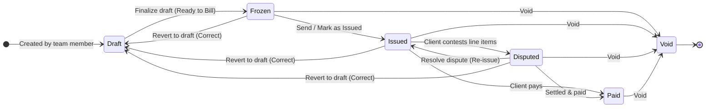

# Data Field Categorization Rules

When implementing new features, tables, or data fields across this platform, you MUST categorize all fields into one of the following four categories and handle them accordingly to prevent overlapping functionality:

## Category 1: Configurable System Fields
- **Definition**: Fields that are natively built into the entity (e.g., Project Name, Project Status, Client Name) but need to be present in the Custom Fields UI so users can configure if they are "Detailed", "Sensitive", or "Private".
- **Implementation**: These should be hardcoded into the `SYSTEM_FIELDS` arrays in the `customize-fields` settings page. Some fields (like Name, Status, Role) are not eligible for `isPrivate`.
- **Backend Enforcement**: Toggles for these are stored in `org_settings.metadata` (e.g. `sysDetailedFields`, `sysPrivateFields`). The backend MUST read these settings and explicitly delete (scrub) the data from API payloads before sending it to the client if the user lacks permissions (e.g., non-owner for Private fields).

## Category 2: Custom Fields
- **Definition**: Fields dynamically created by the user (e.g., custom dates, custom text, single-select dropdowns).
- **Implementation**: Saved as `custom_field_definitions` in the database. Their values are stored inside the `customFields` JSONB column of the entity. They respect "Detailed", "Sensitive", and "Private" checks.
- **Backend Enforcement**: The backend MUST filter these out of the `customFields` JSONB payload before sending it to the client if the user lacks the required PBAC permissions. Hiding them in the UI is not enough.

## Category 3: Immutable Auto-Fields (Metadata)
- **Definition**: Fields automatically generated by the database/system (e.g., `createdAt`, `updatedAt`, `createdBy`). These are read-only metadata.
- **Implementation**: DO NOT put these in the Custom Fields schema builder because users cannot configure them. Instead, they should be toggled in the UI via user-level Table View Settings (e.g., a "Columns" dropdown on the data tables).

## Category 4: Computed / Financial Fields
- **Definition**: Aggregated or sensitive computed fields (e.g., `totalExpenses`, `totalRevenue`, `invoiceCount`).
- **Implementation**: DO NOT govern these via the Custom Fields "Sensitive" toggle. Financial and computed data MUST be strictly wrapped in hardcoded Role-Based Access Control (PBAC) components (e.g., `<Can I="finance:view_expenses">`). If a user does not have the explicit hardcoded permission, the column/field must be completely hidden.

# Invoice Builder & Formula Rules

## 1. Formula Token Evaluation Order (`formula-evaluator.ts`)
- **Order Requirement**: When evaluating row charges, base row tokens (e.g. `ROW3`) MUST be exposed in the `tokens` dictionary BEFORE evaluating the row's charges (e.g. `ROW3 * 1`).
- **Rationale**: If charges are evaluated before base tokens are registered, formulas referencing the base row token return `null`, rendering erroneous `—` (dash) fallback values instead of `0`.

## 2. Token vs. Label Independence
- **Rule**: Editing or updating a `chargeToken` must NEVER overwrite or auto-generate the charge's custom `label`. Tokens and labels are strictly decoupled and independent for both row charges and section charges.

## 3. Two-Column Table Layout Conventions (`template-row-list.tsx`)
- **USD1 (Left Column)**: Displays base values for rows with charges, or charge values for charge lines. Clickable/editable when formula/value can be configured.
- **USD2 (Right Column)**: Displays total values (`rowBase + rowChargesSum`). Rendered only on rows without charges or on the final charge row of a group. Read-only.
- **Uneditable Cell Guidance**: Uneditable cells must explicitly render a `"NOT EDITABLE"` placeholder if empty, and carry a `title="Not editable"` HTML tooltip if populated.

## 4. Single-Value Row Architecture & Formula Codec (`formula-codec.ts`)
- **Row Architecture**: Parent rows (`template_rows`) directly hold `valueType` (`normal` | `formula`), `formula`, and `initialValue`. Sub-components are obsolete and bypassed.
- **UUID Formula Encoding**: Formulas are stored in the database using immutable unified token UUID tags: `{{$tok:UUID}}` (with `_BASE` and `_CHARGES` variants). Legacy tags (`{{$row:}}`, `{{$sec:}}`, `{{$tpl:}}`) are completely purged.
- **Display vs Storage**: All API endpoints MUST call `decodeFormula` before serving formulas to the client (converting UUID tags to current token names) and call `encodeFormula` before writing to the database. Renaming a row token never breaks existing stored formulas because references are bound by UUID.

## 5. Formula Operator Syntax & Sugar
- **Percentage Syntax**: In user inputs, `50%` or `.5%` is syntactic sugar for `(50/100)` or `(0.5/100)`. It must be converted before evaluating or persisting.
- **Modulo Operator**: In user inputs, integer remainder / modulo is represented as `//`. In backend math engines and database formulas, it is mapped to `%`.
- **No Prefix Equals Sign**: The formula bar does NOT use an `=` prefix. Formulas start directly with numbers, tokens, or parentheses.

## 6. Formula Bar Input & Keystroke Constraints (`template-formula-bar.tsx`)
- **Keystroke Gating**: Only valid operators (`+`, `-`, `*`, `/`, `//`, `%`, `(`, `)`), numbers `0-9`, decimal point `.`, and characters matching active token prefixes are accepted.
- **Auto-Capitalization**: All alphabetic characters are automatically transformed to uppercase (`UPPER_SNAKE_CASE`).
- **Strict Spacing Rules**:
  - Literal spaces CANNOT be manually typed or deleted by the user.
  - Pressing `<Space>` converts to an underscore (`_`) if it matches a valid token path; otherwise, the keystroke is rejected.
  - Spaces exist strictly on both sides of operators (e.g. ` + `, ` - `, ` * `, ` / `, ` // `) and nowhere else.
  - Smart Backspace deletes an entire operator block (e.g., ` + `) atomically.
- **Closing Parenthesis Guard**: Typing `)` is rejected if closing count would exceed the currently opened `(` count.
- **Parentheses Syntax Coloring**: Matched parentheses pairs must be visually distinguished by depth using the `SyntaxOverlay` layer with distinct color tiers (`pink-500`, `blue-500`, `emerald-500`, `amber-500`, `cyan-500`).

## 7. Autocomplete & Token Fuzzy Matching
- **Fuzzy Token Matching**: Autocomplete filtering ignores underscores (e.g., typing `lightcharges` or `lightc` matches `LIGHT_CHARGES`).
- **Targeted Character Highlighting**: Suggestion dropdowns highlight matched characters while leaving structural underscores unhighlighted (`renderHighlightedToken`).
- **Self-Reference Exclusion**: The active cell's own token and its `_TOTAL` variant must be filtered out of the autocomplete list to prevent circular loops.

## 8. Save-Time Formula Validation (Frontend & Backend)
- **Frontend Interceptor (`handleSave`)**: Must block saving, display a toast error, and refocus the input if:
  1. The formula ends with an operator.
  2. Parentheses are unbalanced or unclosed.
  3. Any word token does not exist in the active template token list (blocks incomplete tokens like `LIGHT`).
  4. Two tokens or numbers are placed adjacent without an operator between them.
- **Backend Rejection (`validateFormulaChars`)**: Returns `422 Unprocessable Entity` if formula syntax is invalid, references undefined tokens, or references the cell's own token (circular reference).

## 9. Token Pool Sidebar & Legend UI Constraints
- **Default Closed Row Dropdowns**: Row token dropdowns in the Token Pool must be collapsed (closed) by default unless they have one or more charge line items (`row.charges && row.charges.length > 0`). Only rows with charges start open.
- **Unified Smooth Background**: Section items in the Token Pool must match the smooth, seamless background of the sidebar without using contrasting block card backgrounds (`bg-card`).
- **Row Tokens Info Placement**: The info `(i)` button for Row Tokens must be positioned directly beside the `Row Tokens ({count})` label inside the Row Tokens tab pill itself.
## 10. Row Formula Badge Hover Expansion (`table-row.tsx`)
- **No Popovers or Action Badges**: Formula badges beside table rows must not render external popover cards or "Click to edit" overlays on hover.
- **Leftward Overlap Expansion**: When hovered, if a formula is truncated in its allocated space (`max-w-[12rem]`), the badge expands **towards the left** (`absolute right-0 top-1`), overlaying table cells (USD2, USD1, label).
- **Multiline Downward Overflow**: If the formula exceeds the expanded max width (`max-w-xl`), it wraps to multiple lines and extends downward over the next row with `z-50`, shadow elevation, and backdrop blur. Non-truncated formulas do not expand into the table on hover.

## 11. Multi-Draft Collaboration & Edit Audit Trail (`invoice-instances.ts`, `drafts.controller.ts`)
- **Unlimited Project Drafts**: Projects can have any number of drafts created by any authorized team member (`finance:manage_invoices`). Drafts are never restricted to 1-per-user-per-project.
- **Organization-Wide Shared Editing**: All members with `finance:manage_invoices` can collaborate on and edit any draft in the organization.
- **Creator Attribution**: Creator user identity is preserved on draft creation and displayed across all views.
- **Lightweight Audit Trail (`editHistory`)**: Every draft logs revisions in `editHistory` with user metadata, action description, and timestamp. Consecutive edits by the same user within 2 minutes coalesce into a single entry; capped at 50 entries.

## 12. Invoice Lifecycle State Machine & Correction Workflow (`invoices.controller.ts`)

- **Disputed Status**: Halts automated collections without destroying sequence or legal audit trail.
- **Revert to Draft (Correct)**: Permitted from `frozen`, `issued`, and `disputed` (never `paid` or `void`). Restores constants, draft rows, draft headers, sets draft name to `Correction: <DocNum>`, logs to audit history, and cleans up the previous invoice record to release sequence/doc number.

## 13. Canonical Domain Tokens & Zero-Float Arithmetic (`token-resolver.service.ts`)
- **Canonical Namespace**:
  - `FILE_<KEY_UPPER>`: Dynamic project custom fields (`customFields`).
  - `EXP_<KEY_UPPER>`: Real-time expense category aggregations.
  - `EXP_TOTAL`: Total recorded project expenses.
  - `PERIOD_START` / `PERIOD_END`: Invoicing billing scope boundaries.
- **Maritime Legacy Purge**: All legacy maritime-specific aliases (`pda`, `fda`) are permanently purged from database schemas, validation schemas, controllers, and formula contexts.
- **Arbitrary Precision (BigNumber)**: All monetary evaluations use `mathjs` BigNumber configured at **20 decimal digits of precision**, eliminating floating-point rounding errors (`0.1 + 0.2 === 0.300000`).

## 14. AST Math Functions & Keystroke Gating (`ast-evaluator.service.ts`, `use-formula-keydown.ts`)
- **Supported AST Functions**: `CLAMP(x, min, max)`, `MIN(...)`, `MAX(...)`, `ROUND(x, decimals)`, `FLOOR(x)`, `CEIL(x)`, `ABS(x)`.
- **Gating Exception for Function Invocations**:
  - Formulas allow a function token name to be followed immediately by `(` without an operator (e.g. `CLAMP(`, `MIN(`).
  - Outside of function invocations, binary operators (`+`, `-`, `*`, `/`, `//`, `%`) strictly require enclosing spaces.
- **Formula Bar Function Tray**: The formula bar provides a collapsible "Show more / less" function tray exposing all available AST math functions.

## 15. Optional Period Billing & Live Dynamic Sync (`generate-invoice-modal.tsx`, `token-resolver.service.ts`)
- **Default Scope (Full Project Lifetime)**:
  - Period-based billing is strictly **optional**. The default mode is **"Full Project Timeline (Dynamic Live Sync)"** with `periodStart = null` and `periodEnd = null`.
  - In dynamic mode, drafts never bake in static expense sums; reopening or previewing drafts evaluates current live expenses dynamically.
- **Specific Billing Period**: When toggled, date pickers define `periodStart` and `periodEnd`, scoping `EXP_*` tokens to expenses within the range `[periodStart, periodEnd]`.
- **Duplicate Expense Guard**: Org settings define `allowDuplicateExpenseBilling` (defaults to false), blocking or warning against re-billing expenses already frozen in prior invoices.

## 16. Backend Math Engine Isolation
- `mathjs` is strictly isolated on the backend Node.js server (`@starter/api`) and is never imported into `@starter/web`. The frontend bundle size impact is strictly **0 KB**.

## 17. Prebuilt Optional Service Rows & Add-On Catalog (`draft-builder.controller.ts`, `invoice-templates.controller.ts`)
- **Full Normal Row Behavior**: Optional service rows (`TemplateOptionalRow`) are mathematically, structurally, and visually normal rows. They are NOT row charges, taxes, or surcharges. They calculate via standard AST formulas or manual numeric rates, appear in standard USD1/USD2 table cells, and sum into section totals.
- **No `ADDON_` Prefix**: Rows retain their canonical upper-snake tokens directly (e.g., `CRANE_RENTAL`). Collision avoidance appends incremental integer suffixes if multiple instances are attached to the same draft (`CRANE_RENTAL_2`, `CRANE_RENTAL_3`).
- **Mathematical Token Immutability**: Staff can customize display labels and override manual values, but the allocated `rowToken` remains immutable so formula references (`ROW_CRANE_RENTAL`), DAG topological ordering, and snapshot schemas remain unbreakable.
- **Template-Level Catalog (`optional_rows`)**: Prebuilt services are stored on `invoice_templates.optional_rows` JSONB column. Draft rows instantiated from this catalog carry `isOptional: true`.
- **Guarded Removal**: The removal endpoint `DELETE /api/invoices/drafts/:id/optional-rows/:rowToken` only allows deletion of rows marked `isOptional: true`, safeguarding foundational core template rows from accidental deletion during drafting.

## 18. Granular Invoicing PBAC Architecture & 3-Tier Hierarchy (`seed-permissions.ts`, `require-permission.ts`, `can.tsx`)
- **Atomic Permissions**:
  - `invoice:fill_values`: Enter numeric rates/quantities for manual and constant rows in drafts.
  - `invoice:edit_line_labels`: Rename or tweak line item display labels in drafts.
  - `invoice:manage_optional_rows`: Attach prebuilt optional service rows and delete optional service rows in drafts.
  - `invoice:author_formulas`: Switch cells to formula mode and author/edit mathematical AST formulas.
  - `invoice:finalize`: Freeze drafts into legally binding, immutable invoices (`Ready to Bill`).
  - `invoice:revert`: Revert frozen/issued/disputed invoices back into draft sessions for correction.
  - `invoice:void`: Retire invoice numbers and void finalized invoices.
  - `invoice:delete`: Delete drafts or voided documents.
- **Legacy Compatibility**:
  - `finance:manage_invoices` and `finance:view_invoices` are automatically mapped to all respective atomic permissions for backwards compatibility (`seed-permissions.ts`, `requireOrgPermission([perm1, perm2])`, `<Can I={[...]} />`).
- **3-Tier Hierarchy Mapping**:
  - **Tier 1 (Architect / Admin)**: Holds `invoice:author_formulas` and `finance:manage_invoices`. Can edit master templates directly via `/org-admin/invoice-templates/:id` (linked directly from the draft page header), manage the template optional rows catalog, and enter arbitrary AST formulas in draft builder mode.
  - **Tier 2 (Accountant / Staff)**: Holds `invoice:fill_values`, `invoice:edit_line_labels`, `invoice:manage_optional_rows`. Can attach optional service rows, customize labels, and input manual rates. Formula bar is locked from editing formulas.
  - **Tier 3 (Clerk)**: Holds `invoice:fill_values`, `invoice:manage_optional_rows`. Can attach optional services and input numbers, but both formula authoring and label editing are strictly locked.
- **Automated Cache Invalidation**:
  - Role updates in `roles.controller.ts` automatically invalidate Redis permission caches (`permission:*`) to prevent stale permissions from persisting.

## 19. Canonical PBAC Permission Registry & Zero Dangling Aliases (`permissions-registry.ts`)
- **Single Source of Truth**: All platform permissions MUST be declared in `packages/db/src/permissions-registry.ts` inside `PERMISSIONS_CATALOG`. The TypeScript union type `AppPermission` is derived directly from this catalog.
- **Zero Dangling Aliases**:
  - Legacy permissions (e.g. `invoice:create`, `invoice:edit`, `staff:provision`) are permanently banned and eradicated from database schemas, seeders, route guards, and UI components.
  - Whenever any global permission is altered or replaced, all occurrences across both frontend and backend MUST be audited and migrated atomically.
- **Foreign Key Violation Prevention (`23503`)**:
  - Role permission arrays in `packages/db/src/org-initializer.ts` (`ownerPerms`, `managerPerms`, `staffPerms`) MUST be strictly typed as `AppPermission[]`.
  - Owner permissions default to `PERMISSIONS_CATALOG.map((p) => p.key)`.
  - It is mathematically impossible for an unregistered permission string to enter the database seeder or trigger a PostgreSQL foreign key violation.
- **Compiler-Enforced Authorization**:
  - Route middleware `requireOrgPermission` in `@starter/api` and UI gate `<Can I={...}>` in `@starter/web` strictly accept `AppPermission | AppPermission[]`. Magic string literals outside the registry are rejected at compile time.
  - Refer to `.agents/skills/permission-lifecycle-management/SKILL.md` for complete lifecycle protocols.

## 20. Token Capsule Formula Editor Architecture & UX Conventions (`formula-bar/token-capsule.tsx`, `formula-bar/index.tsx`)
- **Minimalist Aesthetic**: Token capsules render concise token keys with zero icons, zero borders, zero boundaries, and zero padding (`px-0 py-0`). They expand to human-friendly metadata on hover.
- **Quick Swap Pill Menu**: Clicking an active capsule opens a non-modal quick swap menu displaying its siblings (`[ Base ]`, `[ Charges ]`, `[ Total ]`), enabling 1-click variant switching without typing.
- **Hierarchical Smart Backspace**: Deleting backward through a token deletes segment-by-segment back to the previous underscore (`_`), stripping known variant suffixes atomically or deleting the full token cleanly.
- **Autocomplete Value Placement & Highlighting**: In the formula bar autocomplete dropdown, live evaluated token values are rendered immediately adjacent to the token name in the exact matching token semantic color with `shrink-0`, guaranteeing that long token names truncate cleanly without ever hiding or truncating values.
- **File Details Field Insertion**: Elements dispatching `insert-token` from header tables (e.g. `FileDetailsHeaderBox`) MUST carry `.insertable-token` class and invoke `e.preventDefault()` on `mousedown` when formula mode is active, preventing formula input blur and unwanted outside-click auto-save triggers.
- **Expense Category Dropdown Standardization**: Dropdowns in `ExpenseCategoriesSection` follow the unified right-aligned caret pattern matching `sections-tree.tsx`, where clicking the container header toggles expand/collapse and clicking the token chip independently inserts `EXP_TOTAL`.

## 21. Row Charge DAG Cycle Isolation & Zero-Compounding Security (`dag-validator.service.ts`, `builder-context.tsx`)
- **Row Base Isolation for Row Charges**: When editing a row charge (`selectedCell.chargeId`), the parent row's base token (`ROW_BASE`) MUST NEVER be seeded as an invalid dependent or hidden in PBAC/builder contexts. Only the charge's own token and row charge sum/total are restricted.
- **Zero-Compounding Security**: Row charges must strictly reference parent row base (`<PARENT>_BASE * <RATE>%`). Referencing the row's total token (`<PARENT>`) is strictly rejected with `CHARGE_SCOPE_VIOLATION` to prevent compounding loops.
- **AST Functions Whitelist**: `FLOOR` and `CEIL` are first-class mathematical primitives registered across `dag-validator.service.ts`, `ast-evaluator.service.ts`, `formula-validator.ts`, and frontend `formula-evaluator.ts`.

## 22. Additional Line Items Studio & Bidirectional Grab-and-Drag Architecture (`token-pool/index.tsx`, `additional-line-items-pool.tsx`, `page.tsx`)
- **Adobe Illustrator-Type Tab UI**: The right-hand studio sidebar toggles seamlessly between `Token Pool` and `Additional Line Items` via top panel tab buttons (`[ Token Pool ]` and `[ Additional Line Items (N) ]`).
- **Table-Body Consistent Aesthetic**: The Additional Line Items catalog matches the 4-column layout of the table body (Grip, Label & Token pill, USD / Rate cell with fx formula badges, Action buttons).
- **Bidirectional Drag-and-Drop (DND)**:
  - Users can grab any line item from the Additional Line Items catalog in the sidebar and drop it directly into any table section (`rows-${sectionId}`).
  - Users can grab any row from a table section and drop it into the Additional Line Items sidebar (`additional-line-items`) to save it to the catalog and remove it from the table.
  - A 1-click alternative "Move to Line Items" is provided in row action dropdown menus.
- **DND Hierarchy & Shared Context**: To avoid `@hello-pangea/dnd` nested `DragDropContext` fatal errors, the studio uses a shared top-level `DragDropContext` with child components (`TemplateBuilderWorkspace`, `FileDetailsHeaderBox`, `TemplateSectionCard`, `TemplateRowList`) accepting `isSharedDnd: true`.
- **DAG Token Collision Prevention**: When dragging or instantiating catalog items into table sections, existing template tokens are scanned and incremental suffixes (`_2`, `_3`) are appended automatically to prevent token collision.

## 23. Workspace Zoom Isolation, Full-Cell Row Selection, Token-Only Creation, & Cross-Section DnD (`page.tsx`, `table-row.tsx`, `add-edit-row-modal.tsx`, `row-list/index.tsx`, `additional-line-items-pool.tsx`)
- **Workspace-Scoped Zoom Isolation**: CSS zoom controls scale only the workspace canvas document (`TemplateBuilderWorkspace`). The top header bar, bottom formula bar, and studio sidebars stay at fixed 100% native scale.
- **Full-Cell Click-to-Edit**: In the row label column, clicking anywhere within the cell container triggers inline select-and-edit mode. Action buttons and token chips stop propagation.
- **Additional Line Items Table Layout & Hover Actions**: The Additional Line Items catalog strictly mirrors the visual layout of table body rows:
  - Column 1: `w-8` serial index (`1, 2, ...`) that reveals `GripVertical` on hover.
  - Column 2: Canonical Token in crisp monospace font with semantic coloring (`getTokenColor`), without heavy background badges.
  - Column 3: Row Label in bold white text (`font-medium text-foreground`) with inline click-to-edit and hover actions pinned to the right edge with gradient fade.
  - Column 4: USD / Rate cell (`tabular-nums font-bold font-mono text-xs`) completely unobstructed.
  - Action buttons: Strictly `[ Edit Token ]` and `[ Delete from Catalog ]`. The `+` (Quick add) button is permanently removed; transferring items into the table is strictly drag-and-drop or via the Add Row modal.
- **Add Row Modal with Catalog Dropdown & Target Section Selector**:
  - Derived label and formula token preview boxes are eradicated from modals.
  - When opening the Add Row modal from the table, users can switch between `[ From Line Items (${catalog.length}) ]` and `[ Create New Token ]`.
  - In catalog mode, selecting a saved line item stamps it into the chosen target section with automatic suffix collision avoidance (`_2`, `_3`).
  - A Target Section dropdown enables routing the line item to any section in the template.
- **Sticky Viewport Clamping for "+ Add Line Item" Button**:
  - The `+ Add Line Item` button sits inside the scroll container directly beneath the last item using `sticky bottom-0 z-20` with a background gradient mask.
  - When items are few (1-3 items), the button renders directly below the last row in normal flow.
  - When items overflow and scroll, the button stays docked to the bottom of the visible sidebar panel so it never scrolls out of sight.
- **Duplicate Line Items Prevention**: Adding duplicate tokens to the Additional Line Items catalog is strictly blocked at the API level (`409 Conflict`) and validated before form submission.
- **Cross-Section DnD & Droppable Invariant**: `TemplateRowList` must never return `null` when `sortedRows.length === 0` in builder mode, ensuring the `<Droppable>` container is registered. Top-level `onDragEnd` supports cross-section movement with optimistic updates and `PATCH` with `sectionId`.

## 24. Table Row Action Hygiene, Catalog Inline Styling, & Formula Bar Auto-Switching (`row-context-menu.tsx`, `additional-line-items-pool.tsx`, `use-save-cell.ts`)
- **Single Edit Pencil for Table Rows**: In table rows, editing the token/row is triggered exclusively via the edit pencil button positioned over the token pill in the left gutter. Redundant edit buttons in the row hover toolbar (`RowActions`) are omitted to eliminate duplicate actions.
- **Seamless Borderless Catalog Inline Input**: Inline editing for line item labels in the Additional Line Items catalog matches the transparent, borderless, zero-padding styling of `LabelCell` in the main table (`bg-transparent border-none outline-none focus:outline-none`).
- **Line Item USD / Rate Formula Bar Integration & Auto-Tab Switch**:
  - Clicking the USD / Rate cell in the Additional Line Items catalog sets `selectedCell` with `isCatalogItem: true` and loads the item's rate or formula into the formula bar.
  - Opening a catalog item's rate cell automatically switches the right sidebar tab from `line-items` to `tokens` (`setSidebarTab("tokens")`), giving the user immediate access to token suggestions and clickable token chips from the Token Pool.
  - Saving the cell sends a PATCH request to `updateTemplateOptionalRow` and invalidates the template catalog query cache.
- **Delete Confirmation Modal for Catalog Line Items**: Deleting an item from the Additional Line Items catalog requires confirmation via `ConfirmDeleteModal`, safeguarding against accidental loss of catalog rows.

## 25. Template-Draft 3-Way Synchronization, Save-As-Template Translation, & Dual-Engine DAG Enforcement (`drafts.controller.ts`, `draft-builder.controller.ts`, `template-sync-modal.tsx`)
- **Two-Stage Formula Translation (`saveAsTemplate`)**: When converting drafts into templates, formulas undergo a strict 2-stage conversion: `decodeFormula` (translating draft UUID tags to bare tokens using draft entity maps) followed by `encodeFormula` (re-encoding bare tokens into new master template `{{$tok:UUID}}` tags). Any draft row carrying `isOptional: true` is inherited into the master template's `optionalRows` catalog.
- **Master Template Version Tracking & Drift Alerts**: Master template mutations (`createRow`, `updateRow`, `deleteRow`, etc.) automatically call `touchTemplate` to increment `invoice_templates.version`. The draft editor checks `GET /template-sync-status` and surfaces an amber `Sync vX Available` button when drift is detected.
- **Non-Destructive 3-Way Merge (`POST /sync-template`)**: Synchronizing drafts against updated master templates brings in new sections and rows, updates master formulas, and preserves user-edited custom row labels, manual amounts, and optional items without data loss.
- **Draft Builder DAG Validation**: `validateDraftDag` is evaluated on all draft row and charge mutations, rejecting circular loops and compounding charge scope violations with `422 Unprocessable Entity`.

## 26. Unified Token Namespace, Zero-Legacy Architecture, & Clean Database Rebuild (`formula-codec.ts`, `wipe-and-rebuild.ts`)
- **Unified Formula Codec**: All formulas are stored strictly as `{{$tok:UUID}}` (with `_BASE` and `_CHARGES` variants). Legacy tags (`{{$row:}}`, `{{$sec:}}`, `{{$tpl:}}`) and legacy regexes are completely eradicated.
- **Prefix Hygiene**: Template constants published to the calculation scope strictly strip duplicate prefixes (`bareKey = key.replace(/^TPL_/, "")`), guaranteeing that duplicate `TPL_TPL_*` tokens never pollute scope.
- **Single-Command Clean Rebuild**: `pnpm --filter @starter/db rebuild` provides an automated end-to-end database wipe (`DROP SCHEMA public CASCADE`), table reconstruction (`drizzle-kit push --force`), trigger installation (`0003_token_triggers.sql`), and clean baseline data seeding (all 89 PBAC permissions, linked Google auth user, org defaults, agency templates, and active client/projects).

## 27. Customizable Sheet Templates, Unified Template Settings, Interactive Column System, & Formula Synchronization (`sheet-builder-workspace.tsx`, `sheet-table-header.tsx`, `sheet-table-row.tsx`, `template-settings-modal.tsx`, `builder-context.tsx`, `use-save-cell.ts`)
- **Archetype Split (`templateType: "standard" | "sheet"`)**: Templates branch cleanly between standard project-bound formula invoices and general-purpose customizable Excel-style sheet templates (`columnDefinitions`, `cellValues`).
- **Interactive Column Drag-to-Resize & Inline `+` Insertion**:
  - Column divider borders feature responsive drag handles (`onMouseDown` + window `mousemove/mouseup`) updating pixel widths (`w: "${finalWidth}px"`).
  - Hovering between columns (and at index 0 and end) reveals rounded `+` pills to insert new columns at that precise index.
  - Column header dropdown context menu provides inline controls: Edit Column, Insert Left, Insert Right, and Delete Column.
- **Unified "Template Settings" Modal Across All Templates**:
  - The legacy "View" popover and "Columns" modal are unified into a single "Template Settings" button (`template-settings-modal.tsx`).
  - For standard templates: presents *Presentation & Layout* and *Document & Indexing* tabs.
  - For sheet templates: adds *Columns & Data* tab (reordering, data types, auto-sum toggles) with zero flex overlap or text clipping.
- **Single-Variant Flat Tokens for Sheet Templates**:
  - Sheet templates have no charges. Redundant `_BASE` and `_CHARGES` variants are completely suppressed in the Token Pool, autocomplete, and context. Each row is strictly `ROW_<TOKEN>` and each section is `SEC_<TOKEN>`.
- **Sheet Details Header Box & Formula Bar Integration**:
  - Maritime file fields are replaced with **"Sheet Details"** (`FileDetailsHeaderBox` with `isSheetMode: true`), supporting custom metadata fields (Department, Period, Prepared By, Notes) with inline editing, adding/deleting fields, and drag-and-drop reordering.
  - Sticky `TemplateFormulaBar` is active in sheet mode.
  - Clicking numeric cells in sheet rows selects them into the formula bar (`columnKey?: string`, `breadcrumb: "${row.label} > ${col.label}"`).
  - Saving cell values updates `cellValues` and evaluates live mathematical formulas into subtotals and grand totals.
- **Centered `+ Add row` Position**:
  - In sheet sections, the `+ Add row` button is centered directly above the section subtotal footer, matching standard templates.

