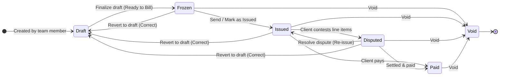

# ADR-0002: Invoice State Machine and Non-Destructive Correction Workflow

- **Status**: Accepted
- **Date**: 2026-10-16
- **Deciders**: Software Architecture Team, Lead Backend Architect
- **Context**: Invoice Management / State Machine & Audit Compliance

---

## Context & Problem Statement

Standard invoicing software often treats invoices either as mutable records (which violates SOC2, tax regulations, and audit requirements) or as strictly terminal once issued (which forces users into painful manual credit-note workarounds whenever an invoice contains a typographical error, wrong address, or disputed line item before payment).

Our system needed a clear, legally compliant lifecycle state machine that supports:
1. Mathematical immutability once finalized (`frozen`).
2. Client contestation handling without destroying the document audit trail.
3. A formal correction workflow allowing reversion to draft before payment is received.

---

## Decision

We defined and implemented an explicit 6-state lifecycle state machine with an atomic `unfreezeInvoice` correction workflow.

### Lifecycle State Machine

### State Definitions & Invariants

1. **`draft`**: Working workspace. Multiple team members can collaborate, edit line items, and adjust formulas.
2. **`frozen`**: Finalized state. The document number is atomically locked from sequence, and 3 immutable JSONB artifacts are snapshot:
   * `historicalFormat`: Evaluated sections, rows, charges, and display labels.
   * `resolvedScope`: Full dictionary of all resolved tokens and external values.
   * `resolvedHeaderValues`: Point-in-time snapshot of entity header fields.
3. **`issued`**: Sent to the client. Legally outstanding receivable.
4. **`disputed`**: Client contests one or more line items. Automated dunning, reminders, and late fees are halted, but the document sequence and legal audit trail remain intact.
5. **`paid`**: Terminal settled state. Cannot be edited, reverted, or corrected. Only allowable transition is `void` under exceptional conditions.
6. **`void`**: Terminal cancelled state. Document number is retired and cannot be reused or reactivated.

### The Correction Workflow (`unfreezeInvoice`)

* **Eligibility**: Permitted from `frozen`, `issued`, and `disputed`. Strictly forbidden from `paid` or `void`.
* **Behavior**:
  1. Restores the invoice's draft sections, rows, charges, and header values into a new draft in `invoice_drafts`.
  2. Sets draft title to `Correction: <DOC_NUMBER>`.
  3. Copies historical audit trail into `editHistory` with a system entry: `"Reverted invoice <DOC_NUMBER> to draft for correction"`.
  4. Cleans up the previous invoice record to release the sequence/document number.

---

## Consequences

* **Positive**:
  * Eliminates orphaned, invalid invoices caused by simple billing corrections.
  * Preserves full multi-draft audit history and attribution.
  * Protects paid receivables from retroactive tampering.
