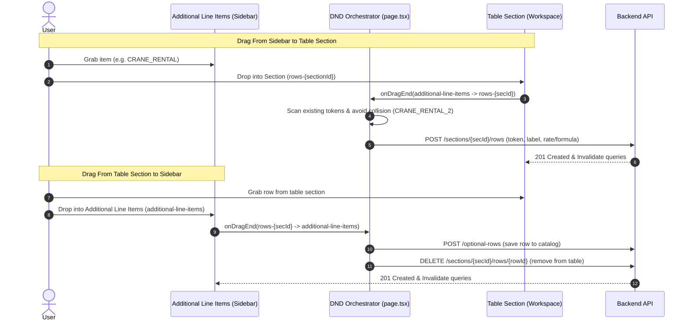

# ADR-0010: Adobe Illustrator Tabbed Studio Sidebar and Bidirectional Grab-and-Drag Line Items Pool

- **Status**: Accepted
- **Date**: 2026-10-18
- **Scope**: Invoice Templates, Draft Builder, Additional Line Items, Token Pool, Drag-and-Drop (DND)

---

## 1. Context & Problem Statement

In previous iterations:
1. Optional Service Rows were managed via a top navbar modal dialog (`TemplateOptionalRowsModal` and `AddOptionalServiceModal`), breaking the fluid visual context of template editing.
2. The user experience felt disconnected from the main table, as users had to open a separate dialog, select an item, choose a section, and submit.
3. The table header box file fields (`FileDetailsHeaderBox`) had an issue where clicking formula-injectable tokens was not properly recognized due to missing `cleanToken` fallbacks.
4. Users wanted an integrated Adobe Illustrator / Photoshop-style panel tab UI where they could toggle between the `Token Pool` and `Additional Line Items` catalog right in the docked sidebar.
5. Users requested a bidirectional grab-and-drag mechanism:
   - Drag line items from the catalog directly into any invoice table section.
   - Grab any existing table row and drag it into the Additional Line Items catalog to save it for reuse and remove it from the table.
   - The visual layout of the Additional Line Items catalog needed to match the visual rhythm of the main invoice table.

---

## 2. Decision & Architecture

### 2.1 Adobe Illustrator-Style Panel Tab Strip (`token-pool/index.tsx`)
- The sidebar header renders two tabs: `[ Token Pool ]` and `[ Additional Line Items (N) ]`.
- Active tabs feature seamless connection to the panel body (`bg-background text-foreground border-border border-t-2 border-t-primary shadow-xs z-10`), matching the Adobe CC panel dock aesthetic.
- The Additional Line Items tab displays a live count badge of catalog items.

### 2.2 Table-Body Matching Visual Rhythm (`additional-line-items-pool.tsx`)
The catalog rows replicate the 4-column structure of table body rows:
1. **Grip Column**: `GripVertical` handle for drag initiation.
2. **Label & Token Column**: Clean typography with concise uppercase canonical token pill (`font-mono text-primary font-semibold`) and optional sub-description.
3. **USD / Rate Column**: Displays numeric values formatted with 2-decimal currency precision or an `fx` pill showing the formula string for formula-computed rows.
4. **Action Column**: Quick-add `+` button and `Trash` delete button.

### 2.3 Shared DND Context Architecture (`isSharedDnd`)
To enable cross-container drag and drop without triggering `@hello-pangea/dnd` nested `DragDropContext` fatal invariant errors:
1. The top-level pages (`TemplateBuilderPage` and `DraftBuilderPage`) wrap the entire split-pane workspace and sidebar within a single `<DragDropContext onDragEnd={handleStudioDragEnd}>`.
2. Child components (`TemplateBuilderWorkspace`, `FileDetailsHeaderBox`, `TemplateSectionCard`, `TemplateRowList`) accept `isSharedDnd: true`. When `isSharedDnd` is enabled, they render `<Droppable>` and `<Draggable>` components without mounting nested `DragDropContext` instances.

### 2.4 Bidirectional Drag-and-Drop Lifecycle

### 2.5 1-Click "Move to Line Items" Alternative
In addition to drag-and-drop, `RowActions` and `MobileRowActions` render a `Move to Line Items` action (`Layers` icon). Clicking it immediately saves the row definition to the catalog and deletes the row from the section.

---

## 3. Consequences

### Positive
- **Streamlined Workflow**: Adding and managing additional line items no longer requires modal interruption.
- **Consistent Visual Language**: The catalog visually mirrors the table body, reducing cognitive load.
- **Robust Collision Avoidance**: Auto-suffixing prevents DAG token collisions when multiple instances of the same service are added.
- **Zero Nested Context Invariants**: `isSharedDnd` prevents `@hello-pangea/dnd` crashes.
