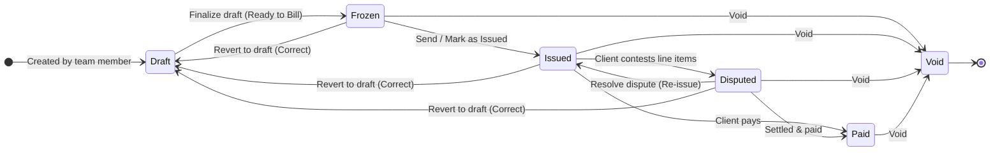

# INVOICE ENGINE — BACKEND AGENT CONSTITUTION
**Location:** `apps/api/src/features/invoices/AGENT.md`
**Version:** 1.0 | **Status:** Binding Architectural Contract
**Read every section before writing a single line of code. No exceptions.**

---

## 0. Critical Reading Instructions

This document is the single source of truth for all backend work on the Invoice Engine. Every API route, database query, algorithm, and error message must conform to this spec. When this document conflicts with your intuition, this document wins. When something is not covered here, choose the safest, most explicit option and document your decision in a code comment.

---

## 1. Codebase Map — Know Where Things Live

```
apps/api/src/
├── features/
│   ├── invoices/                        ← YOU ARE BUILDING HERE
│   │   ├── AGENT.md                     ← this file
│   │   ├── invoices.route.ts
│   │   ├── invoices.controller.ts
│   │   ├── invoices.service.ts
│   │   ├── templates.route.ts
│   │   ├── templates.controller.ts
│   │   ├── templates.service.ts
│   │   ├── org-configs.route.ts
│   │   ├── org-configs.controller.ts
│   │   ├── pdf-layout.route.ts
│   │   ├── pdf-layout.controller.ts
│   │   └── engine/
│   │       ├── token-resolver.ts        ← resolves all {{TOKEN}} values
│   │       ├── dag-validator.ts         ← cycle detection + topological sort
│   │       ├── ast-evaluator.ts         ← mathjs BigNumber execution
│   │       ├── text-interpolator.ts     ← {{$TOKEN}} in label/description fields
│   │       ├── document-number.ts       ← invoice number generation
│   │       └── engine.types.ts          ← all shared engine TypeScript types
│   └── expenses/                        ← existing (do not break)
│   └── projects/                        ← existing (do not break)
├── infra/
│   └── middleware/
│       ├── auth.ts                      ← requireAuth, requireActiveAccount
│       └── role.ts                      ← requireRole
└── index.ts                             ← register your new routers here
```

```
packages/db/src/schema/
├── invoices.ts                          ← REPLACE ENTIRELY
├── expense_categories.ts                ← ADD tokenKey column
├── projects.ts                          ← ADD fileSequenceNumber column
└── invoices/                            ← CREATE THIS DIRECTORY
    ├── org-configs.ts
    ├── pdf-layouts.ts
    ├── invoice-sequences.ts
    ├── invoice-templates.ts
    ├── template-sections.ts
    ├── template-rows.ts
    ├── template-header-fields.ts
    ├── invoice-drafts.ts
    ├── invoices.ts                      ← new replacement
    └── invoice-line-items.ts
```

---

## 2. Existing Schema — What You Must Know Before Touching Anything

### Tables You Will READ FROM (do not break their structure):

**`projects`** — This is the "File" entity in business language. Staff record expenses against projects.
- Columns: `id (text PK)`, `organizationId (FK→organizations)`, `clientId (FK→clients)`, `name`, `status (enum)`, `customFields (jsonb)`, `archivedAt`, timestamps
- You must ADD: `fileSequenceNumber integer` (nullable initially, then set via migration logic)
- `customFields` JSONB is where maritime-specific data lives (GRT, NRT, vessel name, voyage, etc.)

**`expenses`** — Categorized cost records against projects.
- Columns: `id`, `organizationId`, `memberId`, `projectId (nullable FK)`, `categoryId (FK→expenseCategories)`, `amount (decimal 12,2)`, `description`, `receiptUrl`, timestamps
- The `categoryId → expenseCategories.id` relationship is how CAT_* tokens are resolved

**`expense_categories`** — The category registry per organization.
- Columns: `id`, `organizationId`, `name`, timestamps
- You must ADD: `tokenKey text UNIQUE per org` — the UPPER_SNAKE_CASE slug that becomes `{{CAT_TRANSPORT}}`
- Adding this column requires a backfill: auto-generate tokenKey from existing category names on migration

**`organizations`** — The multi-tenant root.
- Columns: `id`, `name`, `slug (unique)`, `logo`, `createdAt`, `metadata (text — do not use, it's a raw text column)`
- Always filter every query by `organizationId` from the authenticated session. Never expose cross-tenant data.

**`users`, `members`** — Auth layer. Use `c.get('user')` from the Hono context (set by `requireAuth` middleware). The `members` table links users to organizations. Always verify the authenticated user is a member of the target organization.

### Tables You Will REPLACE (existing data can be discarded in dev mode):

**`invoices`** — Currently has a primitive schema (`organizationId`, `clientId`, `projectId`, `status enum`, timestamps). This entire table and its enum are being replaced. The existing `invoiceStatusEnum` values (`open`, `paid`, `void`, `uncollectible`) will be replaced.

**`invoice_line_items`** — Currently has `invoiceId`, `expenseId (nullable FK)`, and basic fields. The `expenseId` philosophy (line items as direct expense links) is wrong for our engine. Full replacement.

---

## 3. System Overview — The Formula-Driven Invoice Engine

### The 4-Table Hybrid Architecture
```
INTENT (Templates — mutable, defines the rules):
  invoice_templates      → the container (name, scope, document type)
  template_sections      → named groups of rows within a template
  template_rows          → individual rows with formula strings (e.g., "{{FILE_GRT}} * 0.306")
  template_header_fields → the invoice header configuration (vessel name, GRT display, etc.)

EXECUTION (Snapshots — immutable once frozen, legally binding):
  invoices               → the frozen document with 3 JSONB artifacts
  invoice_line_items     → computed dollar values per row at freeze time
```

### The 5 Non-Negotiable Goals
1. **Industry-Agnostic**: No hardcoded domain concepts. All rows are defined by admins dynamically.
2. **Automated Expense Bridge**: `{{CAT_TRANSPORT}}` automatically pulls `SUM(expenses) WHERE category.tokenKey = 'TRANSPORT'`.
3. **Excel-Like Formula Engine**: Sequential AST evaluation with a scope dictionary. Row A can reference Row B's result if B evaluates first.
4. **Controlled Overrides**: Staff modify drafts without touching organization templates. Presets fork cleanly.
5. **SOC2 Immutability**: Three JSONB artifacts frozen atomically at invoice generation time. Old invoices never retroactively change.

---

## 4. All Postgres Enums to Create

```typescript
// template_scope_enum
'organization'    // Admin-created, official company format, cannot be edited by staff
'preset'          // Staff-forked, personal reuse format

// row_type_enum
'formula'         // Value computed from formulaRaw token expression
'constant'        // Admin-set fixed numeric value, pre-filled on every invoice
'manual'          // Empty on creation, staff inputs value per invoice
'section_aggregate' // Applies a formula to the SUM of all non-aggregate rows in a target section
'multi_value'     // One logical row with multiple sub-components (each has own formula/value)
'header_label'    // Non-calculating label row for visual section headers in the PDF
'grand_total'     // Special row: sums all sectionSums or specified rows

// header_field_type_enum
'file_field'      // Value comes from projects table or projects.customFields
'org_constant'    // Value comes from organization_configs, same for every invoice
'manual'          // Staff fills this in per invoice (ETA, cargo quantity, etc.)

// invoice_status_enum (REPLACES existing)
'draft'           // Being built, can be mutated
'frozen'          // Mathematically locked, historicalFormat written
'issued'          // Sent to client (PDF generated and sent)
'paid'            // Payment received
'void'            // Cancelled, documentNumber retired
'disputed'        // Under dispute, frozen but flagged

// document_type_enum
'general'         // General purpose invoice
'standard'        // Standard commercial invoice
'retainer'        // Retainer / recurring invoice
'proforma'        // Proforma invoice
'credit_note'     // Credit note adjustment

// config_value_type_enum
'number'          // Plain numeric (e.g., exchange rate: 121.20)
'percentage'      // Decimal stored, displays as % (e.g., VAT rate: 0.15 → displays "15%")
'currency_rate'   // Exchange rate (enforces: must be > 0)
'text'            // Text value, NOT injectable into formulas
```

---

## 5. Complete Database Schema Specification

### 5.1 `organization_configs`
Stores ORG_* formula tokens and org-wide constants.
```
id:                  text PK, defaultFn: randomUUID()
organizationId:      text NOT NULL, FK → organizations.id, onDelete: cascade
configKey:           text NOT NULL                     -- e.g., 'VAT_RATE', 'EXCHANGE_RATE'
configValue:         text NOT NULL                     -- stored as string, cast on use
displayLabel:        text NOT NULL                     -- e.g., 'VAT Rate (15%)'
valueType:           config_value_type_enum NOT NULL
isFormulaInjectable: boolean NOT NULL DEFAULT true     -- false = text-only, never in formulas
updatedByUserId:     text, FK → users.id, onDelete: set null
createdAt:           timestamp NOT NULL DEFAULT now()
updatedAt:           timestamp NOT NULL DEFAULT now(), $onUpdate

UNIQUE: (organizationId, configKey)
INDEX: (organizationId, isFormulaInjectable)
```

### 5.2 `invoice_pdf_layouts`
Per-organization PDF document branding and format configuration. One row per org.
```
id:                    text PK, defaultFn: randomUUID()
organizationId:        text NOT NULL UNIQUE, FK → organizations.id, onDelete: cascade
logoUrl:               text
companyDisplayName:    text NOT NULL
companyTagline:        text
invoiceNumberFormat:   text NOT NULL DEFAULT '{DOC_TYPE}-{FILE_SEQ}'
                       -- Pattern variables: {ORG_CODE}, {DOC_TYPE}, {FILE_SEQ},
                       --   {DOC_SEQ}, {YEAR}, {MONTH}, {MONTH_YEAR}, {CUSTOM_VOYAGE}
generalPrefix:         text NOT NULL DEFAULT 'INV'
standardPrefix:        text NOT NULL DEFAULT 'INV'
proformaPrefix:        text NOT NULL DEFAULT 'PRO'
retainerPrefix:        text NOT NULL DEFAULT 'RET'
creditNotePrefix:      text NOT NULL DEFAULT 'CRN'
currentDocSequence:    integer NOT NULL DEFAULT 0      -- LOCKED on every document generation
defaultPaymentTerms:   text
bankDetails:           jsonb                           -- shape: BankDetailsV1
extraSections:         jsonb DEFAULT '[]'              -- shape: ExtraSectionV1[]
footerBlocks:          jsonb DEFAULT '[]'              -- shape: FooterBlockV1[]
showSubtotalColumn:    boolean NOT NULL DEFAULT true   -- show left USD column for rows with surcharge
detailColumnSeparator: text NOT NULL DEFAULT 'newline' -- 'pipe' | 'hyphen' | 'newline' | 'none'
createdAt:             timestamp NOT NULL DEFAULT now()
updatedAt:             timestamp NOT NULL DEFAULT now(), $onUpdate
```

### 5.3 `invoice_document_sequences`
Tracks per-organization file sequence. One row per org. Locked on every file creation.
```
id:             text PK, defaultFn: randomUUID()
organizationId: text NOT NULL UNIQUE, FK → organizations.id, onDelete: cascade
currentValue:   integer NOT NULL DEFAULT 0
createdAt:      timestamp NOT NULL DEFAULT now()
updatedAt:      timestamp NOT NULL DEFAULT now(), $onUpdate
```

### 5.4 `invoice_reserved_numbers`
Pre-generated document numbers reserved at project/file creation time.
```
id:             text PK, defaultFn: randomUUID()
organizationId: text NOT NULL, FK → organizations.id, onDelete: cascade
projectId:      text NOT NULL, FK → projects.id, onDelete: cascade
documentType:   document_type_enum NOT NULL
documentNumber: text NOT NULL
isUsed:         boolean NOT NULL DEFAULT false    -- true once an invoice is frozen with this number
usedByInvoiceId: text, FK → invoices.id, onDelete: set null
createdAt:      timestamp NOT NULL DEFAULT now()

UNIQUE: (projectId, documentType)                 -- one reserved number per type per file
INDEX: (organizationId, projectId)
```

### 5.5 `invoice_templates`
The template header. Container for sections and rows.
```
id:                   text PK, defaultFn: randomUUID()
organizationId:       text NOT NULL, FK → organizations.id, onDelete: cascade
name:                 text NOT NULL
description:          text
documentType:         document_type_enum NOT NULL DEFAULT 'general'
scope:                template_scope_enum NOT NULL DEFAULT 'organization'
currency:             text NOT NULL DEFAULT 'USD'
version:              integer NOT NULL DEFAULT 1       -- incremented on structural edits
isArchived:           boolean NOT NULL DEFAULT false   -- soft delete, NEVER hard delete
createdByUserId:      text NOT NULL, FK → users.id, onDelete: restrict
sourceTemplateId:     text, FK → invoice_templates.id, onDelete: set null
                      -- set when this template was forked from another (preset creation)
createdAt:            timestamp NOT NULL DEFAULT now()
updatedAt:            timestamp NOT NULL DEFAULT now(), $onUpdate

INDEX: (organizationId, scope, isArchived)
INDEX: (organizationId, documentType)
```

### 5.6 `template_sections`
Named groupings of rows within a template. Each section gets a computable SUM token.
```
id:            text PK, defaultFn: randomUUID()
templateId:    text NOT NULL, FK → invoice_templates.id, onDelete: cascade
name:          text NOT NULL                   -- e.g., 'Port Mandatory Costs'
sectionToken:  text NOT NULL                   -- UPPER_SNAKE_CASE, e.g., 'PORT_COSTS'
               -- makes {{SECTION_PORT_COSTS_SUM}} available as a formula token
sortOrder:     integer NOT NULL DEFAULT 0
createdAt:     timestamp NOT NULL DEFAULT now()
updatedAt:     timestamp NOT NULL DEFAULT now(), $onUpdate

UNIQUE: (templateId, sectionToken)
INDEX: (templateId, sortOrder)
```

### 5.7 `template_rows`
Individual rows within sections. The core formula unit.
```
id:                        text PK, defaultFn: randomUUID()
templateId:                text NOT NULL, FK → invoice_templates.id, onDelete: cascade
sectionId:                 text, FK → template_sections.id, onDelete: set null
                           -- null = unsectioned rows (rare, allowed for grand_total type)
rowToken:                  text NOT NULL
                           -- UPPER_SNAKE_CASE, e.g., 'PORT_DUES', 'VAT_LINE'
                           -- makes {{ROW_PORT_DUES}} available in subsequent formulas
rowType:                   row_type_enum NOT NULL
label:                     text NOT NULL
                           -- supports text interpolation: "PORT DUES @ {{$ORG_RATE}} PER GRT"
subDescription:            text
                           -- supports text interpolation: "PER GRT X 0.306 × {{$FILE_GRT}}"
surchargeLabel:            text
                           -- right-aligned label shown when surchargeFormula exists
                           -- e.g., "MANDATORY 15%VAT + 10% AIT"
qualifier:                 text
                           -- selected from org-configured dropdown: "AS PER PORT TARIFF"
formulaRaw:                text
                           -- the base formula: "{{FILE_GRT}} * {{ORG_PORT_RATE}}"
                           -- null for rowType: 'constant', 'manual', 'header_label'
formulaAst:                jsonb
                           -- pre-parsed mathjs AST, cached on save for faster evaluation
surchargeFormula:          text
                           -- optional: "BASE * {{ORG_VAT_RATE}} + BASE * {{ORG_AIT_RATE}}"
                           -- 'BASE' is a reserved token meaning: this row's baseValue
constantValue:             numeric(20, 6)
                           -- for rowType: 'constant' only
defaultValue:              numeric(20, 6)
                           -- for rowType: 'manual': pre-fills but staff can override
isDefaultOverrideable:     boolean NOT NULL DEFAULT true
subComponents:             jsonb
                           -- for rowType: 'multi_value' only, shape: SubComponentV1[]
aggregateTargetSectionId:  text, FK → template_sections.id, onDelete: set null
                           -- for rowType: 'section_aggregate'
                           -- which section's SUM this row applies its formula to
                           -- can differ from this row's own sectionId (pre-declared aggregates)
computationCurrency:       text NOT NULL DEFAULT 'USD'
isVisible:                 boolean NOT NULL DEFAULT true
                           -- false = intermediate computation, never printed in PDF
sortOrder:                 integer NOT NULL DEFAULT 0
createdAt:                 timestamp NOT NULL DEFAULT now()
updatedAt:                 timestamp NOT NULL DEFAULT now(), $onUpdate

UNIQUE: (templateId, rowToken)
INDEX: (templateId, sectionId, sortOrder)
INDEX: (templateId, sortOrder)
```

### 5.8 `template_header_fields`
The invoice header configuration. Defines what appears in the header block of the PDF.
```
id:                text PK, defaultFn: randomUUID()
templateId:        text NOT NULL, FK → invoice_templates.id, onDelete: cascade
fieldType:         header_field_type_enum NOT NULL
label:             text NOT NULL              -- display label: 'GRT', 'NAME OF VESSEL'
sortOrder:         integer NOT NULL DEFAULT 0
columnPosition:    text NOT NULL DEFAULT 'left'  -- 'left' | 'right'
fileFieldKey:      text
                   -- for 'file_field': the customFields key (e.g., 'grt', 'nrt')
                   -- or a direct projects column name (e.g., 'name' for project.name)
isFormulaInjectable: boolean NOT NULL DEFAULT false
                   -- true for GRT, NRT (usable in body formulas as FILE_GRT, FILE_NRT)
                   -- false for VESSEL NAME (display-only)
orgConfigKey:      text
                   -- for 'org_constant': the key in organization_configs
defaultManualValue: text
                   -- for 'manual': optional pre-fill
placeholder:       text
                   -- for 'manual': input hint shown in invoice generator UI
createdAt:         timestamp NOT NULL DEFAULT now()
updatedAt:         timestamp NOT NULL DEFAULT now(), $onUpdate

INDEX: (templateId, sortOrder)
```

### 5.9 `invoice_drafts`
Auto-save scratchpad. One per user per project. Deleted on successful freeze.
```
id:                    text PK, defaultFn: randomUUID()
organizationId:        text NOT NULL, FK → organizations.id, onDelete: cascade
projectId:             text NOT NULL, FK → projects.id, onDelete: cascade
userId:                text NOT NULL, FK → users.id, onDelete: cascade
sourceTemplateId:      text, FK → invoice_templates.id, onDelete: set null
sourceTemplateVersion: integer
draftHeaderValues:     jsonb NOT NULL DEFAULT '{}'
                       -- shape: Record<headerFieldId, string>
draftSections:         jsonb NOT NULL DEFAULT '[]'
                       -- shape: DraftSectionV1[] — complete snapshot of rows as modified
lastAutoSavedAt:       timestamp NOT NULL DEFAULT now()
createdAt:             timestamp NOT NULL DEFAULT now()
updatedAt:             timestamp NOT NULL DEFAULT now(), $onUpdate

UNIQUE: (projectId, userId)        -- one draft per person per file
INDEX: (organizationId, projectId)
```

### 5.10 `invoices` — FULL REPLACEMENT OF EXISTING TABLE
```
id:                     text PK, defaultFn: randomUUID()
organizationId:         text NOT NULL, FK → organizations.id, onDelete: restrict
projectId:              text NOT NULL, FK → projects.id, onDelete: restrict
clientId:               text NOT NULL, FK → clients.id, onDelete: restrict
documentType:           document_type_enum NOT NULL
documentNumber:         text NOT NULL          -- e.g., 'ECSL/INV/042/09-25'
status:                 invoice_status_enum NOT NULL DEFAULT 'draft'
sourceTemplateId:       text, FK → invoice_templates.id, onDelete: set null
sourceTemplateVersion:  integer
generatedByUserId:      text NOT NULL, FK → users.id, onDelete: restrict
issuedToClientName:     text NOT NULL          -- denormalized at freeze time
currency:               text NOT NULL DEFAULT 'USD'
totalBaseAmount:        numeric(20, 6)         -- sum of all baseValues (left column)
totalSurchargeAmount:   numeric(20, 6)         -- sum of all surchargeValues
grandTotalAmount:       numeric(20, 6)         -- sum of all totalValues (right column)
notes:                  text

-- THE THREE FROZEN ARTIFACTS (written atomically at freeze time, never mutated after)
historicalFormat:       jsonb                  -- shape: HistoricalFormatV1
resolvedScope:          jsonb                  -- shape: ResolvedScopeV1
resolvedHeaderValues:   jsonb                  -- shape: Record<fieldId, string>
schemaVersion:          text NOT NULL DEFAULT '1.0'

-- LIFECYCLE TIMESTAMPS
frozenAt:               timestamp
issuedAt:               timestamp
dueAt:                  timestamp
paidAt:                 timestamp
voidedAt:               timestamp
voidReason:             text

createdAt:              timestamp NOT NULL DEFAULT now()
updatedAt:              timestamp NOT NULL DEFAULT now(), $onUpdate

UNIQUE: (organizationId, documentNumber)
INDEX: (organizationId, status)
INDEX: (organizationId, projectId)
INDEX: (organizationId, createdAt DESC)
```

### 5.11 `invoice_line_items` — FULL REPLACEMENT OF EXISTING TABLE
```
id:                        text PK, defaultFn: randomUUID()
invoiceId:                 text NOT NULL, FK → invoices.id, onDelete: cascade
sectionToken:              text              -- denormalized from template_section.sectionToken
sectionName:               text              -- frozen section name at generation time
rowToken:                  text NOT NULL     -- e.g., 'PORT_DUES'
rowType:                   row_type_enum NOT NULL
label:                     text NOT NULL     -- frozen label with text interpolation resolved
subDescription:            text              -- frozen sub-description with values resolved
surchargeLabel:             text
qualifier:                 text
formulaSnapshot:           text              -- exact formulaRaw string used at freeze time
surchargeFormulaSnapshot:  text              -- exact surchargeFormula used at freeze time
subComponentsSnapshot:     jsonb             -- frozen sub-components for multi_value rows
baseValue:                 numeric(20, 6)    -- result of formulaRaw evaluation
surchargeValue:            numeric(20, 6)    -- result of surchargeFormula evaluation (0 if none)
totalValue:                numeric(20, 6) NOT NULL  -- baseValue + surchargeValue
computationCurrency:       text NOT NULL DEFAULT 'USD'
isVisible:                 boolean NOT NULL DEFAULT true
displayOrder:              integer NOT NULL
createdAt:                 timestamp NOT NULL DEFAULT now()

INDEX: (invoiceId, displayOrder)
```

---

## 6. JSONB Type Contracts — TypeScript Interfaces

Define these in `apps/api/src/features/invoices/engine/engine.types.ts`. Every JSONB column has exactly one TypeScript interface. Use Zod schemas for parse-time validation.

```typescript
// HistoricalFormatV1 — stored in invoices.historicalFormat
// The formula structure exactly as it existed at freeze time
export interface HistoricalFormatV1 {
  schemaVersion: '1.0'
  templateId: string
  templateVersion: number
  templateName: string
  sections: Array<{
    id: string
    name: string
    sectionToken: string
    sortOrder: number
    rows: Array<{
      id: string
      rowToken: string
      rowType: RowType
      label: string
      subDescription?: string
      surchargeLabel?: string
      qualifier?: string
      formulaRaw?: string
      surchargeFormula?: string
      constantValue?: string   // BigNumber serialized as string
      subComponents?: SubComponentV1[]
      aggregateTargetSectionId?: string
      isVisible: boolean
      sortOrder: number
    }>
  }>
  headerFields: Array<{
    id: string
    fieldType: HeaderFieldType
    label: string
    fileFieldKey?: string
    orgConfigKey?: string
    columnPosition: 'left' | 'right'
    sortOrder: number
  }>
}

// ResolvedScopeV1 — stored in invoices.resolvedScope
// Every token and its exact resolved value at freeze time
export interface ResolvedScopeV1 {
  schemaVersion: '1.0'
  resolvedAt: string              // ISO timestamp
  projectId: string
  tokens: Record<string, string>  // token key → BigNumber serialized as string
  // Examples:
  // "CAT_TRANSPORT": "4200.000000"
  // "ORG_VAT_RATE": "0.150000"
  // "FILE_GRT": "20151.000000"
  // "ROW_PORT_DUES": "6166.206000"
  // "SECTION_PORT_COSTS_SUM": "8196.206000"
}

// DraftSectionV1 — stored in invoice_drafts.draftSections
export interface DraftSectionV1 {
  id: string
  name: string
  sectionToken: string
  sortOrder: number
  rows: DraftRowV1[]
}

export interface DraftRowV1 {
  id: string
  rowToken: string
  rowType: RowType
  label: string
  subDescription?: string
  surchargeLabel?: string
  qualifier?: string
  formulaRaw?: string
  surchargeFormula?: string
  overriddenValue?: string   // if staff changed a constant/formula
  subComponents?: SubComponentV1[]
  aggregateTargetSectionId?: string
  isVisible: boolean
  sortOrder: number
}

// SubComponentV1 — stored in template_rows.subComponents & invoice_line_items.subComponentsSnapshot
export interface SubComponentV1 {
  id: string                       // uuid, stable across saves
  label: string
  formulaRaw?: string              // e.g., "{{FILE_GRT}} * 0.306"
  constantValue?: string           // BigNumber as string
  isManual: boolean                // true = staff inputs value per invoice
  manualValue?: string             // the value staff entered (in draft and line items)
  sortOrder: number
}

// BankDetailsV1 — stored in invoice_pdf_layouts.bankDetails
export interface BankDetailsV1 {
  companyName: string
  companyAddress?: string
  accountNo: string
  bankName: string
  bankBIC: string
  bankBranch?: string
  bankAddress?: string
  intermediaryBankName?: string
  intermediaryAccountNo?: string
  intermediaryBIC?: string
}

// ExtraSectionV1 — stored in invoice_pdf_layouts.extraSections (array)
export interface ExtraSectionV1 {
  id: string
  title: string
  rows: Array<{ label: string; value: string }>
}

// FooterBlockV1 — stored in invoice_pdf_layouts.footerBlocks (array)
export interface FooterBlockV1 {
  id: string
  type: 'text' | 'address' | 'contact_line'
  content: string
}

// EvaluatedRow — output of the AST Evaluator
export interface EvaluatedRow {
  rowToken: string
  rowType: RowType
  label: string                    // text interpolation already resolved
  subDescription?: string
  surchargeLabel?: string
  qualifier?: string
  formulaSnapshot?: string
  surchargeFormulaSnapshot?: string
  subComponentsSnapshot?: SubComponentV1[]
  baseValue: string                // BigNumber as string
  surchargeValue: string           // BigNumber as string
  totalValue: string               // BigNumber as string
  isVisible: boolean
  displayOrder: number
  sectionToken?: string
}

// EngineError — thrown by any engine module
export interface EngineError {
  code: EngineErrorCode
  message: string
  rowToken?: string
  token?: string
  formula?: string
  details?: Record<string, unknown>
}

export type EngineErrorCode =
  | 'TOKEN_NOT_FOUND'
  | 'CIRCULAR_DEPENDENCY'
  | 'FORWARD_REFERENCE'
  | 'DIVISION_BY_ZERO'
  | 'EVALUATION_FAILED'
  | 'NEGATIVE_VALUE_NOT_ALLOWED'
  | 'INVALID_FORMULA_SYNTAX'
  | 'SECTION_NOT_FOUND'
  | 'MULTI_VALUE_COMPONENT_ERROR'
```

---

## 7. Token Namespace — The Complete Resolution Contract

Every `{{TOKEN}}` in a formula belongs to exactly one namespace. The resolver must handle each differently.

```
PREFIX     | SOURCE                    | RESOLUTION STRATEGY
-----------+---------------------------+------------------------------------------------
CAT_*      | expense_categories        | SELECT SUM(amount) FROM expenses
           |                           | JOIN expense_categories ec ON e.categoryId = ec.id
           |                           | WHERE e.projectId = ? AND ec.tokenKey = 'TRANSPORT'
           |                           | GROUP BY ec.tokenKey
-----------+---------------------------+------------------------------------------------
FILE_*     | projects + customFields   | projects.customFields['grt'] for FILE_GRT
           |                           | projects.name for FILE_PROJECT_NAME
           |                           | projects.clientId resolved for FILE_CLIENT_NAME
           |                           | Defined by template_header_fields WHERE
           |                           | isFormulaInjectable = true
-----------+---------------------------+------------------------------------------------
ORG_*      | organization_configs      | WHERE configKey = 'VAT_RATE'
           |                           | AND isFormulaInjectable = true
           |                           | AND organizationId = ?
           |                           | Cast configValue to BigNumber based on valueType
-----------+---------------------------+------------------------------------------------
SECTION_*  | (computed)                | SECTION_{sectionToken}_SUM = SUM of totalValues
           |                           | of all non-aggregate rows in that section
           |                           | Computed progressively during evaluation
-----------+---------------------------+------------------------------------------------
ROW_*      | (scope dictionary)        | ROW_{rowToken} = result added to scope after
           |                           | each row is successfully evaluated
           |                           | Available only to rows that come AFTER in
           |                           | topological order
-----------+---------------------------+------------------------------------------------
BASE       | (reserved)                | Used ONLY in surchargeFormula.
           |                           | Equals this row's baseValue.
           |                           | Not valid in formulaRaw.
```

---

## 8. Engine Module Specifications

### 8.1 Token Resolver (`engine/token-resolver.ts`)

```
Function: resolveScope(input: {
  projectId: string,
  organizationId: string,
  headerFields: TemplateHeaderField[]  // to know which FILE_* tokens are injectable
}): Promise<Record<string, string>>   // token → BigNumber as string

Algorithm:
1. Query expense_categories WHERE organizationId = ?
   → for each category, store tokenKey → 'CAT_{tokenKey}'
2. Query SUM(expenses) GROUP BY categoryId WHERE projectId = ?
   → map categoryId to tokenKey, store 'CAT_{tokenKey}' = SUM
   → categories with no expenses get 0, not undefined
3. Query organization_configs WHERE organizationId = ? AND isFormulaInjectable = true
   → for each config: store 'ORG_{configKey}' = configValue
   → percentage type: store as decimal (0.15, not 15)
4. Query projects WHERE id = ?
   → for each headerField WHERE isFormulaInjectable = true:
     - fileFieldKey = 'grt': read project.customFields['grt']
     - fileFieldKey = 'name': read project.name
     - store as 'FILE_{fieldKey.toUpperCase()}'
5. All values stored as strings (BigNumber serialized)
6. NEVER return undefined for a requested token. If a token has no data, return '0'.
7. Log which tokens resolved to 0 (for debugging missing data issues)
```

### 8.2 DAG Validator (`engine/dag-validator.ts`)

```
Function: validateAndSort(rows: TemplateRow[]): {
  valid: boolean,
  topologicalOrder: string[],   // rowTokens in evaluation order
  errors: EngineError[]
}

Algorithm (Kahn's):
1. For each row, extract all {{TOKEN}} references from formulaRaw + surchargeFormula
   → use regex: /\{\{([A-Z_]+)\}\}/g
2. ROW_* references create dependency edges between rows
   → ROW_PORT_DUES in row B means B depends on the 'PORT_DUES' row
3. SECTION_* references create dependency on ALL rows in that section
4. CAT_*, ORG_*, FILE_* are leaf nodes (no row dependencies)
5. BASE is valid only in surchargeFormula, creates no dependencies
6. Build adjacency list + in-degree map
7. Run Kahn's algorithm:
   - Initialize queue with all rows having in-degree 0
   - Process queue: add to result, decrement neighbors' in-degrees
   - If neighbor reaches 0: add to queue
8. If result.length < rows.length: cycle detected
   → identify which rows remain with in-degree > 0
   → return error: CIRCULAR_DEPENDENCY with the rowTokens involved
9. Validate: if a ROW_* reference doesn't match any rowToken in the template
   → return error: TOKEN_NOT_FOUND for that specific row and token
10. This function runs at SAVE TIME on every row mutation. Not only at preview/generate.
```

### 8.3 AST Evaluator (`engine/ast-evaluator.ts`)

```
Function: evaluate(input: {
  rows: TemplateRow[],               // already in topological order
  scope: Record<string, string>,     // from token resolver + progressive ROW_* additions
  subComponentManualValues?: Record<string, string>  // for multi_value rows in drafts
}): EvaluatedRow[]

Algorithm:
1. Configure mathjs: math.config({ number: 'BigNumber', precision: 20 })
2. Convert scope to BigNumber map: Map<string, BigNumber>
3. For each row in topological order:
   a. If rowType === 'header_label': skip (no computation)
   b. If rowType === 'constant': baseValue = constantValue
   c. If rowType === 'manual': baseValue = manualValue from scope (or 0 if not provided)
   d. If rowType === 'multi_value':
      → evaluate each subComponent (formula or constant or manual value)
      → baseValue = sum of all subComponent values
   e. If rowType === 'formula':
      → replace all {{TOKEN}} with scope values
      → evaluate using math.evaluate(formula, mathScope)
      → catch: division by zero → EngineError DIVISION_BY_ZERO
      → catch: NaN result → EngineError EVALUATION_FAILED
   f. If rowType === 'section_aggregate':
      → SECTION_SUM = sum of totalValues of all non-aggregate rows in aggregateTargetSectionId
      → inject SECTION_SUM into local scope
      → evaluate surchargeFormula equivalent (the aggregate formula)
      → baseValue = SECTION_SUM, surchargeValue = formula result
   g. Evaluate surchargeFormula if present:
      → replace BASE with baseValue
      → resolve all {{TOKEN}} references
      → surchargeValue = result
   h. totalValue = baseValue + surchargeValue
   i. Add to scope: ROW_{rowToken} = totalValue (as string)
   j. Update section running total: sectionSums[sectionToken] += totalValue
   k. Update scope: SECTION_{sectionToken}_SUM = current sectionSum
4. Return EvaluatedRow[]

Error contract:
  ALL errors are EngineError objects. Never throw raw JavaScript errors.
  Every EngineError includes: code, rowToken, the formula that failed, and
  the scope snapshot at time of failure (for debugging).
```

### 8.4 Text Interpolator (`engine/text-interpolator.ts`)

```
Function: interpolate(text: string, scope: Record<string, string>): string

Rules:
- {{TOKEN_NAME}} → renders as the token key itself (literal text, e.g., "GRT")
  Use case: "PORT DUES @ US$ 0.306 PER {{FILE_GRT}}" → "PORT DUES @ US$ 0.306 PER FILE_GRT"
  This is for referencing the field name in descriptions.
- {{$TOKEN_NAME}} → renders as the resolved value (e.g., "20151")
  Use case: "PORT DUES @ US$ 0.306 PER GRT X {{$FILE_GRT}}" → "...PER GRT X 20151"
- Percentage values: {{$ORG_VAT_RATE}} where value = 0.15 AND valueType = 'percentage'
  → renders as "15%" (auto-format based on valueType)
- Unknown tokens: leave as-is (do not throw, do not substitute empty string)
- This function runs at PDF generation time, NOT at formula evaluation time.
```

### 8.5 Document Number Generator (`engine/document-number.ts`)

```
Function: generateDocumentNumber(input: {
  organizationId: string,
  projectId: string,
  documentType: DocumentType,
  db: Database,                       // must be called INSIDE a transaction
}): Promise<string>

Algorithm (MUST be called inside the invoice generation transaction):
1. SELECT * FROM invoice_pdf_layouts WHERE organizationId = ? FOR UPDATE NOWAIT
   → throws if lock cannot be acquired immediately
2. Read format pattern: e.g., '{DOC_TYPE}/{FILE_SEQ}/{YEAR}'
3. Resolve each pattern variable:
   {ORG_CODE}      → organizations.slug
   {DOC_TYPE}      → layout.pdaPrefix / layout.fdaPrefix (based on documentType param)
   {FILE_SEQ}      → project.fileSequenceNumber.toString().padStart(3, '0')
   {DOC_SEQ}       → (layout.currentDocSequence + 1).toString().padStart(3, '0')
   {YEAR}          → new Date().getFullYear().toString()
   {MONTH}         → (new Date().getMonth() + 1).toString().padStart(2, '0')
   {MONTH_YEAR}    → MM-YY format
4. UPDATE invoice_pdf_layouts SET currentDocSequence = currentDocSequence + 1 WHERE id = ?
5. Return composed string

CRITICAL: This function must only be called inside db.transaction(). 
If called outside a transaction, throw: Error('generateDocumentNumber must be called inside a transaction')
```

---

## 9. Complete API Endpoint Specification

### Router Registration
All invoice routes register at `/api` root in `apps/api/src/index.ts`.

```
/api/org-configs          → orgConfigsRouter
/api/invoice-pdf-layouts  → pdfLayoutRouter
/api/invoice-templates    → templatesRouter
/api/invoices             → invoicesRouter
```

### 9.1 Org Configs

```
GET    /api/org-configs
       Auth: requireAuth + requireActiveAccount
       Query: orgId from session
       Returns: OrgConfig[] filtered by session org

POST   /api/org-configs
       Auth: requireAuth + requireActiveAccount + requireRole('admin')
       Body: { configKey, configValue, displayLabel, valueType, isFormulaInjectable }
       Validate: configKey must be UPPER_SNAKE_CASE, unique per org
       Returns: created OrgConfig

PATCH  /api/org-configs/:id
       Auth: requireAuth + requireActiveAccount + requireRole('admin')
       Body: { configValue?, displayLabel?, isFormulaInjectable? }
       IMPORTANT: if configKey changes, run token rename impact analysis
       Returns: updated OrgConfig + impactedFormulaCount

DELETE /api/org-configs/:id
       Auth: requireAuth + requireActiveAccount + requireRole('admin')
       Guard: if used in any template formula → return 409 with impactedFormulas list
       Returns: 204
```

### 9.2 PDF Layout

```
GET  /api/invoice-pdf-layouts
     Auth: requireAuth + requireActiveAccount
     Returns: PdfLayout for session org (or 404 if not configured)

PUT  /api/invoice-pdf-layouts
     Auth: requireAuth + requireActiveAccount + requireRole('admin')
     Upsert: create if not exists, update if exists
     Body: all layout fields
     Returns: PdfLayout

GET  /api/invoice-pdf-layouts/preview
     Auth: requireAuth + requireActiveAccount + requireRole('admin')
     Returns: a sample PDF buffer using dummy data to preview the layout
```

### 9.3 Invoice Templates

```
GET    /api/invoice-templates
       Auth: requireAuth + requireActiveAccount
       Query: ?scope=organization|preset&documentType=general|standard|retainer|proforma|credit_note&archived=false
       Returns: InvoiceTemplate[] with section+row counts, NO row data

POST   /api/invoice-templates
       Auth: requireRole('admin') for scope='organization', requireRole('user') for scope='preset'
       Body: { name, description, documentType, scope, currency }
       Returns: created InvoiceTemplate (empty, no sections/rows)

GET    /api/invoice-templates/:id
       Auth: requireAuth + requireActiveAccount
       Returns: full template: sections → rows (sorted by sortOrder), headerFields

PATCH  /api/invoice-templates/:id
       Auth: requireRole('admin') for org templates, owner for presets
       Body: { name?, description?, currency?, documentType? }
       Side effect: increment template.version
       Returns: updated template

DELETE /api/invoice-templates/:id
       Auth: requireRole('admin')
       Action: soft delete only (set isArchived = true)
       Guard: NEVER hard delete. If template has associated invoices, only archive.
       Returns: 200

POST   /api/invoice-templates/:id/fork
       Auth: requireAuth + requireActiveAccount
       Action: clone template + all sections + all rows as new template with scope='preset'
       Body: { name }
       Sets: sourceTemplateId = :id on the new template
       Returns: new template ID
```

### 9.4 Template Sections

```
POST   /api/invoice-templates/:id/sections
       Auth: requireRole('admin')
       Body: { name, sectionToken, sortOrder }
       Validate: sectionToken UPPER_SNAKE_CASE, unique per template
       Returns: created section

PATCH  /api/invoice-templates/:id/sections/:sectionId
       Auth: requireRole('admin')
       Body: { name?, sortOrder? }
       Note: sectionToken is IMMUTABLE after creation (would break formulas)
       Returns: updated section

DELETE /api/invoice-templates/:id/sections/:sectionId
       Auth: requireRole('admin')
       Guard: if section has rows, require ?force=true or move rows first
       Returns: 204

PATCH  /api/invoice-templates/:id/sections/reorder
       Auth: requireRole('admin')
       Body: { sections: Array<{ id, sortOrder }> }
       Action: bulk update sortOrder values
       Returns: 200
```

### 9.5 Template Rows

```
POST   /api/invoice-templates/:id/rows
       Auth: requireRole('admin')
       Body: full row fields
       CRITICAL: run DAG validation before saving. If cycle detected → 409 with cycle details
       Side effect: if formulaRaw changed, re-parse and cache formulaAst
       Side effect: increment template.version
       Returns: created row + DAG validation result

PATCH  /api/invoice-templates/:id/rows/:rowId
       Auth: requireRole('admin')
       Body: any row fields
       CRITICAL: run DAG validation after applying changes. If cycle → 409, do not save
       Side effect: cache formulaAst if formulaRaw changed
       Returns: updated row + DAG validation result

DELETE /api/invoice-templates/:id/rows/:rowId
       Auth: requireRole('admin')
       Guard: check if any other rows reference this row's rowToken in their formulas
       If referenced → 409 with list of referencing rows
       Returns: 204

PATCH  /api/invoice-templates/:id/rows/reorder
       Auth: requireRole('admin')
       Body: { rows: Array<{ id, sectionId, sortOrder }> }
       Action: bulk update sectionId and sortOrder (supports drag between sections)
       Returns: 200
```

### 9.6 Template Header Fields

```
POST   /api/invoice-templates/:id/header-fields
PATCH  /api/invoice-templates/:id/header-fields/:fieldId
DELETE /api/invoice-templates/:id/header-fields/:fieldId
PATCH  /api/invoice-templates/:id/header-fields/reorder
       Body: { fields: Array<{ id, sortOrder, columnPosition }> }
```

### 9.7 Token Discovery

```
GET  /api/invoices/tokens
     Auth: requireAuth + requireActiveAccount
     Query: ?projectId=&templateId= (optional, for context-aware token list)
     Returns:
     {
       categories: [{ tokenKey, displayName, token: 'CAT_{tokenKey}' }]
                   -- DISTINCT tokenKey from expense_categories WHERE orgId = ?
                   -- includes categories with 0 expenses (they still show as tokens)
       orgConfigs: [{ configKey, displayLabel, token: 'ORG_{configKey}', valueType }]
                   -- WHERE isFormulaInjectable = true
       fileFields:  [{ fieldKey, displayLabel, token: 'FILE_{fieldKey}' }]
                   -- WHERE isFormulaInjectable = true from template header fields
       sections:   [{ sectionToken, name, token: 'SECTION_{sectionToken}_SUM' }]
                   -- only if templateId is provided
       rows:       [{ rowToken, label, token: 'ROW_{rowToken}' }]
                   -- only if templateId is provided, for cross-row references
     }
```

### 9.8 Invoice Preview

```
POST /api/invoices/preview
     Auth: requireAuth + requireActiveAccount
     Body: {
       projectId: string,
       templateId?: string,         -- use template rows
       draftRows?: DraftSectionV1[] -- or use draft rows (for generator overrides)
       headerFieldValues?: Record<string, string>  -- manual field overrides
     }
     Action:
       1. Resolve token scope
       2. Get rows (from template or draft)
       3. Run DAG validation (return errors without evaluating if invalid)
       4. Run AST evaluator
       5. Run text interpolator on labels/descriptions
     Returns: {
       sections: EvaluatedSection[],
       grandTotal: string,
       resolvedScope: ResolvedScopeV1,
       validationErrors: EngineError[]
     }
     CRITICAL: NO database writes. This is a read-only computation endpoint.
```

### 9.9 Invoice Drafts

```
GET    /api/invoices/drafts?projectId=
       Returns: InvoiceDraft | null

PUT    /api/invoices/drafts
       Body: { projectId, sourceTemplateId?, draftHeaderValues, draftSections }
       Action: upsert (create or replace) WHERE (projectId, userId)
       Sets: lastAutoSavedAt = NOW()
       Returns: InvoiceDraft

DELETE /api/invoices/drafts/:id
       Returns: 204
```

### 9.10 Invoice Generation

```
POST /api/invoices/generate
     Auth: requireAuth + requireActiveAccount
     Body: {
       projectId: string,
       documentType: DocumentType,
       sourceTemplateId?: string,
       draftRows?: DraftSectionV1[],
       headerFieldValues: Record<string, string>,
       notes?: string
     }
     Action: THE ATOMIC FREEZE TRANSACTION — see Section 11
     Returns: { invoiceId, documentNumber, status: 'frozen' }

POST /api/invoices/:id/issue
     Auth: requireOrgPermission('finance:manage_invoices')
     Action: status 'frozen' or 'disputed' → 'issued', set issuedAt = NOW()
     Returns: updated invoice

POST /api/invoices/:id/dispute
     Auth: requireOrgPermission('finance:manage_invoices')
     Body: { reason?: string }
     Action: status 'issued' → 'disputed' (pauses dunning/collections)
     Returns: updated invoice

POST /api/invoices/:id/mark-paid
     Auth: requireOrgPermission('finance:manage_invoices')
     Action: status 'issued' or 'disputed' or 'frozen' → 'paid'
     Returns: updated invoice

POST /api/invoices/:id/unfreeze
     Auth: requireOrgPermission('finance:manage_invoices')
     Guard: invoice status must be 'frozen', 'issued', or 'disputed' (never 'paid' or 'void')
     Action: Reverts invoice back to mutable draft. Restores template constants, sets
             draft name to 'Correction: {documentNumber}', appends audit log entry,
             and deletes the previous invoice record to free sequence locks.
     Returns: { success: true, draftId }

POST /api/invoices/:id/void
     Auth: requireOrgPermission('finance:manage_invoices')
     Body: { voidReason?: string }
     Action: status → 'void', set voidedAt, voidReason
     Returns: updated invoice

GET  /api/invoices/:id/pdf
     Auth: requireAuth + requireActiveAccount
     Action: generate PDF from frozen invoice data + pdf layout config
     Returns: PDF buffer (application/pdf)

GET  /api/invoices?projectId=&status=
     Returns: Invoice[] with line item counts, NO line item data

GET  /api/invoices/:id
     Returns: full invoice + all line items (sorted by displayOrder)
```

### 9.11 Invoice Lifecycle & State Machine



#### State Transition Matrix & Invariants
1. **Draft Collaboration**: Multiple drafts per project allowed. Any user with `finance:manage_invoices` can edit. Changes logged to `editHistory` with user ID, name, email, action, and timestamp. Consecutive edits within 2 minutes coalesce into one entry.
2. **Frozen (`Ready to Bill`)**: Finalized snapshot stored. Ready for client issuance or early correction.
3. **Issued**: Officially transmitted to client. Automated collection/reminders active.
4. **Disputed**: Halts automated collections when a client contests a charge. Preserves original document number and paper trail without canceling. Can be resolved (`disputed` → `issued`), paid (`disputed` → `paid`), reverted to draft for corrections, or voided.
5. **Revert to Draft (Correction Workflow)**:
   - Permitted from `frozen`, `issued`, or `disputed`. Strictly forbidden once `paid` or `void`.
   - Restores draft rows, draft headers, and `draftConstants`.
   - Renames draft to `Correction: <Document Number>` and appends audit log: `"Reverted from invoice <Document Number> for corrections"`.
   - Deletes old invoice record to avoid duplicate sequence collision when finalized again.

---

## 10. The Atomic Freeze Transaction — Step by Step

This is the most critical function in the entire system. It must be a single database transaction. Zero partial states.

```typescript
// apps/api/src/features/invoices/engine/invoice-freeze.ts
async function freezeInvoice(params: FreezeParams): Promise<FrozenInvoice> {
  return await db.transaction(async (tx) => {
    // STEP 1: Idempotency guard — prevent double-submit race condition
    const existing = await tx.select().from(invoices)
      .where(and(eq(invoices.projectId, params.projectId),
                 eq(invoices.status, 'generating')))
      .limit(1)
    if (existing.length > 0) throw new Error('INVOICE_GENERATION_IN_PROGRESS')

    // STEP 2: Set generating flag (within transaction — rolled back on failure)
    const [invoice] = await tx.insert(invoices).values({
      ...baseInvoiceData,
      status: 'generating'
    }).returning()

    // STEP 3: Lock PDF layout for document number generation
    // SELECT FOR UPDATE happens inside generateDocumentNumber
    const documentNumber = await generateDocumentNumber({
      organizationId: params.organizationId,
      projectId: params.projectId,
      documentType: params.documentType,
      db: tx
    })

    // STEP 4: Fresh token resolution (never use cached scope)
    const scope = await resolveScope({
      projectId: params.projectId,
      organizationId: params.organizationId,
      headerFields: templateHeaderFields,
      db: tx
    })

    // STEP 5: Fresh DAG validation + topological sort
    const { topologicalOrder, errors } = validateAndSort(rows)
    if (errors.length > 0) throw new EngineError('CIRCULAR_DEPENDENCY', ...)

    // STEP 6: Full evaluation
    const evaluatedRows = evaluate({ rows: orderedRows, scope })

    // STEP 7: Text interpolation on labels/descriptions
    const interpolatedRows = evaluatedRows.map(row => ({
      ...row,
      label: interpolate(row.label, scope),
      subDescription: row.subDescription ? interpolate(row.subDescription, scope) : undefined
    }))

    // STEP 8: Write line items
    await tx.insert(invoiceLineItems).values(
      interpolatedRows.map((row, idx) => ({
        invoiceId: invoice.id,
        ...row,
        displayOrder: idx,
        baseValue: row.baseValue,
        surchargeValue: row.surchargeValue,
        totalValue: row.totalValue
      }))
    )

    // STEP 9: Build the three JSONB artifacts
    const historicalFormat: HistoricalFormatV1 = buildHistoricalFormat(template, rows)
    const resolvedScope: ResolvedScopeV1 = {
      schemaVersion: '1.0',
      resolvedAt: new Date().toISOString(),
      projectId: params.projectId,
      tokens: scope
    }

    // STEP 10: Finalize invoice — atomic status change to 'frozen'
    const [frozen] = await tx.update(invoices)
      .set({
        status: 'frozen',
        documentNumber,
        historicalFormat,
        resolvedScope,
        resolvedHeaderValues: params.headerFieldValues,
        grandTotalAmount: computeGrandTotal(evaluatedRows),
        frozenAt: new Date(),
        schemaVersion: '1.0'
      })
      .where(eq(invoices.id, invoice.id))
      .returning()

    // STEP 11: Mark reserved number as used
    await tx.update(invoiceReservedNumbers)
      .set({ isUsed: true, usedByInvoiceId: frozen.id })
      .where(and(
        eq(invoiceReservedNumbers.projectId, params.projectId),
        eq(invoiceReservedNumbers.documentType, params.documentType)
      ))

    // STEP 12: Delete the draft
    await tx.delete(invoiceDrafts)
      .where(and(
        eq(invoiceDrafts.projectId, params.projectId),
        eq(invoiceDrafts.userId, params.userId)
      ))

    return frozen
    // ON ANY THROW: entire transaction rolls back. No partial state persists.
  })
}
```

---

## 11. Security Rules — Non-Negotiable

1. **Every query must filter by `organizationId` from the session.** Never trust `organizationId` from the request body.
2. **Verify org membership before any data access.** The user's `member.organizationId` must match the target org.
3. **`organization` scoped templates**: only admins can create/edit/delete.
4. **`preset` scoped templates**: only the creator can edit/delete their own preset. Admins can delete any.
5. **Invoice generation**: any authenticated active member of the org can generate. The `generatedByUserId` is always from the session.
6. **PDF download**: only members of the owning organization.
7. **Cross-tenant isolation**: it is impossible for a query in this feature to return data belonging to a different organization. Every single `WHERE` clause must include `organizationId = sessionOrgId`.

---

## 12. Error Handling Standards

```typescript
// Every HTTP error response uses this shape:
{
  success: false,
  error: {
    code: string,        // machine-readable: 'TEMPLATE_NOT_FOUND', 'CIRCULAR_DEPENDENCY'
    message: string,     // human-readable
    details?: unknown    // additional context (e.g., which rows are in a cycle)
  }
}

// HTTP status codes:
400  → validation errors, invalid formula syntax, bad request body
403  → insufficient role, not org member
404  → template/invoice/config not found (in this org)
409  → conflict: circular dependency on save, template in use on delete, duplicate token key
422  → engine error during preview/generate (formula evaluation failed)
500  → unexpected server error (log fully, return generic message to client)
```

---

## 13. Hard Rules — Never Break These

1. **NEVER use JavaScript `number` or `parseFloat` for any monetary calculation.** Use `mathjs` with `BigNumber` precision 20 for all formula evaluation. Use `numeric(20, 6)` for all database monetary columns.
2. **NEVER write `historicalFormat`, `resolvedScope`, or `resolvedHeaderValues` outside of the freeze transaction.**
3. **NEVER hard-delete a template that has associated invoices.** Soft delete only (isArchived = true).
4. **NEVER mutate an invoice with `status = 'frozen'`, `'issued'`, `'paid'`, or `'void'`.** These are immutable states.
5. **NEVER call `generateDocumentNumber` outside a database transaction.** The counter increment must be atomic with the invoice write.
6. **NEVER skip the DAG validation on row save.** A circular dependency that reaches the database is a production bug.
7. **NEVER trust `organizationId` from the request body.** Always use `session.user.activeOrganizationId`.
8. **NEVER use `drizzle-kit push`.** Schema changes via `drizzle-kit generate` + `drizzle-kit migrate` only.
9. **The preview endpoint must NEVER write to the database.** It is read-only computation.
10. **All JSONB blobs must be validated with Zod schemas before reading and before writing.** Never assume a JSONB shape.
