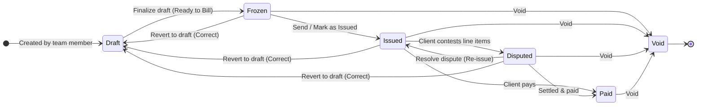

# Invoice Drafts Submodule

**Location:** `apps/api/src/features/invoices/drafts/agent.md`  
**Binding Architectural Contract for AI Agents**

---

## 1. Core Responsibilities
- Manages the lifecycle of invoice drafts (`invoice_drafts` table).
- Implements collaborative fill-time editing without mutating the underlying master template.
- Manages snapshot seeding from invoice templates into draft JSONB state via `DraftSeeder`.
- Tracks creator attribution and maintains a lightweight audit trail of all revisions.

## 2. Invariants & Rules

### 2.1 Multi-Draft Collaboration & Audit Logging
1. **Multiple Concurrent Drafts**: Any authorized team member (`finance:manage_invoices`) can create any number of independent drafts per project. The legacy single-draft unique constraint (`projectId, userId`) is removed.
2. **Organization-Wide Shared Editing**: All members with `finance:manage_invoices` can open, inspect, and edit any draft in the organization.
3. **Creator Attribution**: The creator's user ID (`draft.userId`) is permanently bound at creation time and eager-loaded (`draft.user`) for display in lists and builder headers.
4. **Lightweight Edit Audit Trail**: Every draft maintains an `editHistory` JSONB array (`DraftEditAuditEntry[]`) recording:
   - `userId`: string
   - `userName`: string (optional)
   - `userEmail`: string (optional)
   - `editedAt`: ISO 8601 string
   - `action`: human-readable description (e.g. "Created draft", "Updated row ROW3", "Reverted from invoice INV-2026-0042 for corrections")
5. **Audit Coalescing**: Consecutive edits by the same user within 2 minutes coalesce into a single entry with updated timestamp to avoid audit log bloat. History is capped at the 50 most recent events.

### 2.2 Template Isolation & Formula Resolution
1. **JSONB Isolation**: When an invoice draft is created from a template, all sections, rows, charges, constants, and headers are copied into the draft's JSONB snapshot (`draftSections`, `draftConstants`, `draftHeaderValues`). Any subsequent changes to master templates do NOT mutate existing drafts.
2. **Token Immutability in Drafts**: Once a draft is initialized, row tokens and charge tokens are immutable to ensure formula resolution consistency.
3. **Manual Values vs Formulas**: In draft fill mode, rows with `valueType = 'normal'` accept staff overrides (`manualValue`). Formulas remain engine-computed.
4. **PBAC**: Access requires `finance:manage_invoices` for creation, upsert, and deletion; `finance:view_invoices` for listing and retrieval.
5. **API Error Hygiene**: All draft controllers catch errors cleanly and return sanitized `{ error: string }` payloads without leaking server stack traces (`err.stack`).

## 3. Draft Lifecycle & Correction State Machine

### Correction Workflow (`unfreezeInvoice`)
- When an issued or disputed invoice requires changes from client feedback, an authorized user clicks **Revert to Draft (Correct)**.
- Allowed source statuses: `frozen`, `issued`, and `disputed` (strictly blocked from `paid` or `void`).
- Restores `draftSections`, `draftHeaderValues`, and template constants (`draftConstants`).
- Auto-names the draft `Correction: <Document Number>` and records an audit entry: `"Reverted from invoice <Document Number> for corrections"`.
- Deletes the previous frozen/issued invoice record to free sequence locks and allow clean re-finalization.

## 4. Key Files
- `draft-audit.ts`: Coalescing audit trail append helper (`appendAuditEntry`).
- `drafts.controller.ts`: REST endpoints for draft list, get, create, upsert, and delete. Eager loads creator `user`.
- `draft-builder.controller.ts`: Customizer endpoints for managing draft-level sections, rows, and charges with automatic audit logging.
- `draft-seeder.ts`: Reads template definitions and relations from DB to produce initial draft JSONB structures.
