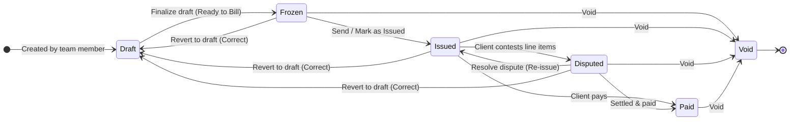

# Invoice Drafts Submodule

**Location:** `apps/api/src/features/invoices/drafts/agent.md`  
**Binding Architectural Contract for AI Agents**

---

## 1. Core Responsibilities
- Manages the lifecycle of invoice drafts (`invoice_drafts` table).
- Implements collaborative fill-time editing without mutating the underlying master template.
- Manages snapshot seeding from invoice templates into draft JSONB state via `DraftSeeder`.
- Supports both standard project-bound formula templates and general multi-column sheet templates.
- Tracks creator attribution and maintains a lightweight audit trail of all revisions.

## 2. Invariants & Rules

### 2.1 Multi-Draft Collaboration & Audit Logging
1. **Multiple Concurrent Drafts**: Any authorized team member (`finance:manage_invoices` or `invoice:create_draft`) can create any number of independent drafts per project.
2. **Organization-Wide Shared Editing**: All members with `finance:manage_invoices` or granular draft permissions can collaborate on drafts in the organization.
3. **Creator Attribution**: The creator's user ID (`draft.userId`) is permanently bound at creation time and eager-loaded (`draft.user`) for display in lists and builder headers.
4. **Lightweight Edit Audit Trail**: Every draft maintains an `editHistory` JSONB array (`DraftEditAuditEntry[]`) recording:
   - `userId`: string
   - `userName`: string (optional)
   - `userEmail`: string (optional)
   - `editedAt`: ISO 8601 string
   - `action`: human-readable description
5. **Audit Coalescing**: Consecutive edits by the same user within 2 minutes coalesce into a single entry with updated timestamp to avoid audit log bloat. History is capped at the 50 most recent events.

### 2.2 Template Isolation, General Templates, & Formula Resolution
1. **JSONB Isolation**: When an invoice draft is created from a template, all sections, rows, charges, constants, headers, and custom column definitions are copied into the draft's JSONB snapshot (`draftSections`, `draftConstants`, `draftHeaderValues`, `draftHeaderFields`). Subsequent master template changes do NOT mutate existing drafts.
2. **General Template Multi-Column Preservation**: `DraftSeeder.hydrateFromTemplate` preserves dynamic `cellValues` for general templates across all rows.
3. **Formula UUID Remapping**: All formula tags `{{$tok:TEMPLATE_ROW_UUID}}` are remapped to new draft row UUIDs during hydration to preserve topological integrity.
4. **Master Template Metadata**: `getDraftById` eager-loads `sourceTemplate` (`templateType`, `columnDefinitions`) so the frontend draft workspace dynamically renders either standard `TemplateBuilderWorkspace` or general `SheetBuilderWorkspace`.
5. **Draft Header Fields Lifecycle**: Drafts maintain independent header description fields (`draftHeaderFields`) with dedicated endpoints for list, create, update, delete, and reorder.

### 2.3 Optional Period Billing & Atomic Freeze Targeting
1. **Custom Draft Naming**: Drafts carry a user-configurable `draftName` (defaulting to the template name or "Correction: <DocNum>").
2. **Optional Period Billing**: Drafts store `periodStart` and `periodEnd` (ISO strings or null). When null, the draft operates in **Full Project Timeline (Live Sync)** mode, dynamically computing newly added project expenses.
3. **Atomic Draft Finalization (`freezeParams.draftId`)**: Finalizing an invoice accepts an optional `draftId`. When provided, the finalization transaction targets that specific draft, computes its snapshot, generates the invoice record, and deletes that exact draft record atomically upon successful commit.

### 2.4 Prebuilt Optional Service Rows & Additional Line Items
1. **Normal Row Architecture**: Optional service rows (`TemplateOptionalRow`) are standard normal rows with normal formula/value fields, displaying in USD1/USD2 table columns and summing into section totals.
2. **Token Naming & Collision Avoidance**: They retain their canonical uppercase snake tokens (e.g. `CRANE_RENTAL`). Sequential integer suffixes (`CRANE_RENTAL_2`, `CRANE_RENTAL_3`) are automatically appended if duplicate instances are added to the draft.
3. **Guarded Removal**: Endpoint `DELETE /api/invoices/drafts/:id/optional-rows/:rowToken` only allows deleting rows marked `isOptional: true`. Any attempt to delete a core template row returns `403 Forbidden`.

### 2.5 Granular PBAC Hierarchy
1. **Atomic Invoicing Permissions**: `invoice:fill_values`, `invoice:edit_line_labels`, `invoice:manage_optional_rows`, `invoice:author_formulas`, `invoice:finalize`, `invoice:revert`, `invoice:void`, `invoice:delete`.
2. **Legacy Super-Permission**: `finance:manage_invoices` grants access across all atomic operations.

## 3. Draft Lifecycle & Correction State Machine

### Correction Workflow (`unfreezeInvoice`)
- When an issued or disputed invoice requires changes from client feedback, an authorized user clicks **Revert to Draft (Correct)**.
- Allowed source statuses: `frozen`, `issued`, and `disputed` (strictly blocked from `paid` or `void`).
- Restores `draftSections`, `draftHeaderValues`, and template constants (`draftConstants`).
- Auto-names the draft `Correction: <Document Number>` and records an audit entry: `"Reverted from invoice <Document Number> for corrections"`.
- Deletes the previous frozen/issued invoice record to free sequence locks and allow clean re-finalization.

## 4. Key Files
- `draft-audit.ts`: Coalescing audit trail append helper (`appendAuditEntry`).
- `drafts.controller.ts`: REST endpoints for draft list, get, create, upsert, and delete. Eager loads creator `user` and `sourceTemplate`.
- `draft-builder.controller.ts`: Customizer endpoints for managing draft-level sections, rows, charges, and header fields.
- `draft-seeder.ts`: Reads template definitions and relations from DB to produce initial draft JSONB structures with formula remapping and multi-column `cellValues`.
