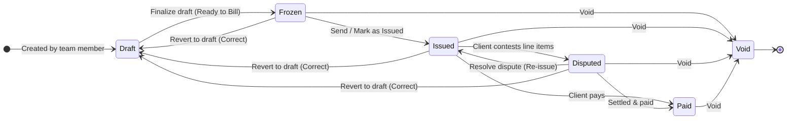

# INVOICE ENGINE — FRONTEND AGENT CONSTITUTION
**Location:** `apps/web/components/features/invoices/AGENT.md`
**Version:** 1.0 | **Status:** Binding Architectural Contract
**Read every section before writing a single line of code. No exceptions.**

---

## 0. Critical Reading Instructions

This document governs all frontend work on the Invoice Engine. Every component, route, state mutation, and UI interaction must conform to this spec. The backend AGENT.md is the sibling document — read both. When in doubt about data shapes, defer to the backend AGENT.md's TypeScript interfaces. This is a production-grade, multi-tenant SaaS interface. It must be correct, fast, and unbreakable.

---

## 1. Tech Stack Reference — What's Available

```
Framework:    Next.js 15 App Router (use server components where possible)
UI:           Shadcn UI primitives + Tailwind CSS
Data:         TanStack Query v5 (React Query) — all server state
DnD:          dnd-kit (@dnd-kit/core, @dnd-kit/sortable) — NOT react-beautiful-dnd
URL State:    nuqs (typesafe URL search params)
Forms:        react-hook-form + zod resolver
Icons:        Lucide React
PDF Preview:  iframe render OR @react-pdf/renderer (decide at implementation)
```

---

## 2. Directory Structure — Strict Separation of Concerns

**RULE**: Page files in `app/` are shells only. All logic lives in `components/features/invoices/`.

```
apps/web/
├── app/
│   ├── (dashboard)/
│   │   └── projects/
│   │       └── [id]/
│   │           └── invoices/
│   │               ├── page.tsx              ← SHELL ONLY: renders <InvoiceListPage />
│   │               ├── new/
│   │               │   └── page.tsx          ← SHELL ONLY: renders <InvoiceGeneratorPage />
│   │               └── [invoiceId]/
│   │                   └── page.tsx          ← SHELL ONLY: renders <InvoiceViewPage />
│   └── (settings)/
│       └── invoices/
│           ├── page.tsx                      ← redirects to /templates
│           ├── templates/
│           │   ├── page.tsx                  ← SHELL ONLY: renders <TemplateListPage />
│           │   ├── new/
│           │   │   └── page.tsx              ← SHELL ONLY: renders <CreateTemplatePage />
│           │   └── [id]/
│           │       └── page.tsx              ← SHELL ONLY: renders <TemplateBuilderPage />
│           ├── layout/
│           │   └── page.tsx                  ← SHELL ONLY: renders <PdfLayoutConfigPage />
│           └── configs/
│               └── page.tsx                  ← SHELL ONLY: renders <OrgConfigsPage />
│
└── components/
    └── features/
        └── invoices/
            ├── AGENT.md                      ← this file
            │
            ├── admin/
            │   ├── TemplateListPage.tsx
            │   ├── CreateTemplatePage.tsx
            │   ├── TemplateBuilderPage.tsx    ← main orchestrator, ~100 lines
            │   ├── template-builder/
            │   │   ├── SectionList.tsx
            │   │   ├── SectionBlock.tsx
            │   │   ├── RowItem.tsx
            │   │   ├── RowTypeSelector.tsx
            │   │   ├── FormulaInput.tsx
            │   │   ├── SurchargeFormulaInput.tsx
            │   │   ├── MultiValueEditor.tsx
            │   │   ├── HeaderFieldsEditor.tsx
            │   │   └── TemplateMetaForm.tsx
            │   ├── PdfLayoutConfigPage.tsx
            │   ├── pdf-layout/
            │   │   ├── BankDetailsForm.tsx
            │   │   ├── ExtraSectionsBuilder.tsx
            │   │   ├── DocumentNumberBuilder.tsx
            │   │   └── FooterBlocksBuilder.tsx
            │   └── OrgConfigsPage.tsx
            │
            ├── generator/
            │   ├── InvoiceGeneratorPage.tsx   ← main orchestrator
            │   ├── TemplateSelectorStep.tsx
            │   ├── HeaderFieldsPanel.tsx
            │   ├── DraftEditorPanel.tsx
            │   ├── FreezeConfirmDialog.tsx
            │   └── CloneFromPastDialog.tsx
            │
            ├── view/
            │   ├── InvoiceListPage.tsx
            │   ├── InvoiceViewPage.tsx
            │   └── InvoiceStatusTimeline.tsx
            │
            └── shared/
                ├── PreviewPanel.tsx           ← SHARED between builder and generator
                ├── TokenInjector.tsx          ← SHARED token dropdown
                ├── FormulaField.tsx           ← base input with token injection
                ├── InvoiceStatusBadge.tsx
                ├── SurchargeFormulaField.tsx
                └── invoice-keys.ts            ← ALL TanStack Query keys
```

---

## 3. TanStack Query Key Architecture

All query keys live in `components/features/invoices/shared/invoice-keys.ts`. Never hardcode a string key outside this file.

```typescript
export const invoiceKeys = {
  // Org Configs
  orgConfigs: {
    all: (orgId: string) => ['org-configs', orgId] as const,
  },

  // PDF Layout
  pdfLayout: {
    byOrg: (orgId: string) => ['pdf-layout', orgId] as const,
  },

  // Templates
  templates: {
    list: (orgId: string, scope?: string) => ['invoice-templates', 'list', orgId, scope] as const,
    detail: (id: string) => ['invoice-templates', 'detail', id] as const,
    rows: (templateId: string) => ['invoice-templates', 'rows', templateId] as const,
  },

  // Tokens
  tokens: {
    byContext: (projectId: string, templateId?: string) =>
      ['invoice-tokens', projectId, templateId] as const,
  },

  // Preview (do NOT cache aggressively — always fresh)
  preview: {
    byDraft: (projectId: string) => ['invoice-preview', projectId] as const,
  },

  // Drafts
  drafts: {
    byProject: (projectId: string) => ['invoice-drafts', 'project', projectId] as const,
  },

  // Invoices
  invoices: {
    list: (projectId: string) => ['invoices', 'list', projectId] as const,
    detail: (id: string) => ['invoices', 'detail', id] as const,
  },
}
```

---

## 4. API Client Conventions

All API calls use the existing project pattern. Create a dedicated client file:
`components/features/invoices/shared/invoice-api.ts`

```typescript
// All functions in this file call the Hono API.
// Use the existing fetch wrapper/client pattern already established in the codebase.
// All functions are typed: input and output types come from the BACKEND AGENT spec.
// Never inline fetch() calls inside React components or hooks.
// Pattern example:
export async function getInvoiceTokens(projectId: string, templateId?: string) {
  const res = await apiClient.get(`/api/invoices/tokens`, {
    params: { projectId, templateId }
  })
  return res.data as TokenDiscoveryResult
}
```

---

## 5. Template Builder — Complete UI Specification

### 5.1 Page Layout (`TemplateBuilderPage.tsx`)

```
┌─────────────────────────────────────────────────────────────────────┐
│  [← Back to Templates]  "Maritime PDA Template"  v3  [Archived]    │
│  [Edit Name]  [Archive]  [Fork as Preset]                           │
├────────────────────────────────────┬────────────────────────────────┤
│  LEFT PANEL (60%)                  │  RIGHT PANEL (40%)             │
│  Template Builder                  │  Live Preview                  │
│  ─────────────────                 │  ─────────────                 │
│  [+ Add Section]                   │  Preview updates on every      │
│                                    │  formula change (300ms debounce│
│  ▼ Port Mandatory Costs            │  calling POST /preview)        │
│    [⠿] Row 1: Port Dues    [✎][✕] │                                │
│    [⠿] Row 2: Pilot Pay    [✎][✕] │  Uses test project for tokens  │
│    [⠿] Row 3: Tug Hire     [✎][✕] │  (configurable in preview bar) │
│    [⠿] Row 4: VAT on sect  [✎][✕] │                                │
│    [+ Add Row]                     │  [Select Test Project ▼]       │
│                                    │                                │
│  ▼ Government Levies               │  Port Mandatory Costs          │
│    [⠿] Row 5: Levy Fund    [✎][✕] │  Port Dues           6,166.21  │
│    [+ Add Row]                     │  Pilot Pay           1,230.00  │
│                                    │  Tug Hire              800.00  │
│  [+ Add Section]                   │  VAT 15%             1,229.43  │
│                                    │  ─────────────────────────────│
│  HEADER FIELDS                     │  Government Levies             │
│  [+ Add Header Field]              │  Levy Fund              16.50  │
│                                    │  ─────────────────────────────│
│                                    │  Grand Total        10,125.82  │
└────────────────────────────────────┴────────────────────────────────┘
```

### 5.2 Section Management

- Each section renders as a collapsible block with a drag handle
- Section header shows: drag handle `[⠿]`, section name (inline editable), row count badge, `[+ Add Row]` button, `[⋮]` menu (Rename, Delete)
- Sections are drag-sortable using `@dnd-kit/sortable`
- Deleting a section with rows shows a confirmation dialog: "This section has X rows. Delete anyway? Rows will become unsectioned."
- The `sectionToken` is shown in small gray text below the section name: `TOKEN: PORT_COSTS`
- `sectionToken` is set at creation time and is NOT editable after creation (it would break formulas)

### 5.3 Row Management

Each row renders as a compact card showing:
```
[⠿] [rowType badge]  Label text here            [✎ Edit] [✕ Delete]
     Formula: {{FILE_GRT}} * 0.306              (gray, truncated)
     Token: PORT_DUES
```

Row editing opens as an **inline expansion** below the row (not a modal). This keeps the full template visible.

Expanded row edit form:
```
Row Type:     [formula ▼]              Row Token: [PORT_DUES          ]
                                                  readonly if used in formulas

Label:        [PORT DUES @ US$ 0.306 PER GRT X {{$FILE_GRT}}]
              [🪙 Insert Token ▼]

Sub-Desc:     [PER GRT X 0.306 × {{$FILE_GRT}} (FOR ONE CALENDAR MONTH)]
              [🪙 Insert Token ▼]

Qualifier:    [AS PER PORT TARIFF ▼]  (admin-configured dropdown)

Formula:      [{{FILE_GRT}} * {{ORG_PORT_RATE}}                        ]
              [🪙 Insert Token ▼]   [✓ Valid] or [⚠ Error: TOKEN_NOT_FOUND]

Surcharge:    [Enable surcharge ☐]
  If checked:
  Surcharge Label: [MANDATORY 15%VAT + 10% AIT                        ]
  Surcharge Formula: [BASE * {{ORG_VAT_RATE}} + BASE * {{ORG_AIT_RATE}}]
                     [🪙 Insert Token ▼]

Visibility:   [✓ Visible in PDF]

[Cancel]  [Save Row]
```

### 5.4 Row Type Selector (`RowTypeSelector.tsx`)

When clicking `[+ Add Row]`, show a selection sheet/dialog:

```
What type of row do you want to add?

○ Formula Row           Calculate a value using tokens and math
  {{FILE_GRT}} * 0.306

○ Constant Row          Fixed value, same on every invoice
  Pre-filled: 1,230.00

○ Manual Row            Staff inputs this value per invoice
  Empty until staff fills in

○ Multi-Value Row       One row with multiple calculation components
  (2500 + 1150 + 1150) / {{ORG_EXCHANGE_RATE}}

○ Section Aggregate     Apply a formula to all rows in a section
  SECTION_SUM * {{ORG_VAT_RATE}}

○ Label Row             Non-calculating section header text
  Visual divider only

[Cancel]  [Continue →]
```

### 5.5 Multi-Value Row Editor (`MultiValueEditor.tsx`)

When row type is `multi_value`, the expanded edit form shows a component list:

```
Components:
  [⠿] [label: "Arrival Tugboat  "] [type: constant ▼] [value: 800   ] [✕]
  [⠿] [label: "Sailing Tugboat  "] [type: constant ▼] [value: 800   ] [✕]
  [+ Add Component]

Formula applied to COMPONENT_SUM:
  [COMPONENT_SUM / {{ORG_EXCHANGE_RATE}}                               ]
  [🪙 Insert Token ▼]

Surcharge:
  [MANDATORY 15%VAT + 5% AIT]
  Formula: [BASE * 0.20                                                ]
```

Component types:
- `constant` — admin sets a fixed value
- `manual` — staff inputs per invoice (shows an input field in the generator)
- `formula` — full formula with token support

### 5.6 Section Aggregate Row Configuration

When row type is `section_aggregate`:
```
Aggregate Target Section:   [Port Mandatory Costs ▼]
                            (dropdown of all sections in this template)
                            Note: can target a different section than this row belongs to

Formula (applied to SECTION_SUM):
  [SECTION_SUM * {{ORG_VAT_RATE}}                                      ]
  [🪙 Insert Token ▼]

Position in template:       This row can be placed anywhere — drag it where needed.
                            SECTION_SUM is always the live sum of the target section.
```

### 5.7 Token Injector (`shared/TokenInjector.tsx`)

A dropdown that appears next to formula inputs. Inserts the selected token at the current cursor position.

```typescript
interface TokenInjectorProps {
  inputRef: React.RefObject<HTMLInputElement | HTMLTextAreaElement>
  projectId?: string     // for context-aware token list
  templateId?: string    // to include ROW_* and SECTION_* tokens
  mode: 'formula' | 'text'
  // formula mode: inserts {{TOKEN}} for formulas
  // text mode: inserts {{$TOKEN}} for value interpolation in labels
}
```

Dropdown structure (grouped):
```
🏢 Organization Constants
   VAT Rate (ORG_VAT_RATE)              → inserts {{ORG_VAT_RATE}}
   Exchange Rate (ORG_EXCHANGE_RATE)    → inserts {{ORG_EXCHANGE_RATE}}
   ...

📁 File (Project) Fields
   GRT (FILE_GRT)                        → inserts {{FILE_GRT}}
   NRT (FILE_NRT)                        → inserts {{FILE_NRT}}
   ...

📦 Expense Categories
   Transport (CAT_TRANSPORT)             → inserts {{CAT_TRANSPORT}}
   Port Dues (CAT_PORT_DUES)             → inserts {{CAT_PORT_DUES}}
   ...

📐 Sections (if templateId provided)
   Port Costs Sum (SECTION_PORT_COSTS)  → inserts {{SECTION_PORT_COSTS_SUM}}
   ...

🔢 Row Values (if templateId provided)
   Port Dues (ROW_PORT_DUES)            → inserts {{ROW_PORT_DUES}}
   ...
```

**Cursor position insertion logic:**
```typescript
function insertAtCursor(
  ref: React.RefObject<HTMLInputElement>,
  token: string
): void {
  const input = ref.current
  if (!input) return
  const start = input.selectionStart ?? input.value.length
  const end = input.selectionEnd ?? input.value.length
  const newValue = input.value.slice(0, start) + token + input.value.slice(end)
  // Trigger React onChange manually (input.value setter + dispatchEvent)
  const nativeInputValueSetter = Object.getOwnPropertyDescriptor(
    window.HTMLInputElement.prototype, 'value'
  )!.set
  nativeInputValueSetter!.call(input, newValue)
  input.dispatchEvent(new Event('input', { bubbles: true }))
  // Restore cursor after token
  requestAnimationFrame(() => {
    input.setSelectionRange(start + token.length, start + token.length)
    input.focus()
  })
}
```

### 5.8 Live Preview Panel (`shared/PreviewPanel.tsx`)

The preview panel calls `POST /api/invoices/preview` with a debounce of 300ms whenever:
- Any formula changes
- Any constant/manual value changes
- The test project selection changes

```typescript
interface PreviewPanelProps {
  templateId: string
  testProjectId: string | null    // set by the admin in the preview bar
  onTestProjectChange: (id: string) => void
}
```

Display:
- Shows sections → rows in order
- Each visible row: label (left), totalValue (right) formatted as currency
- Rows with surcharge: show baseValue in smaller text above, totalValue bold
- `isVisible: false` rows: shown in the builder with a dimmed/strikethrough style but NOT in the PDF preview column
- Validation errors: each row with an error shows a red badge `⚠ Error: TOKEN_NOT_FOUND {{FILE_GRT}}`
- Grand total: shown at the bottom
- Loading state: skeleton rows
- If no test project selected: show message "Select a test project to see live values"

---

## 6. Invoice Generator — Complete UI Specification

### 6.1 Page Layout (`InvoiceGeneratorPage.tsx`)

```
┌──────────────────────────────────────────────────────────────────────┐
│  Project: MV Oceanic Queen  ›  Generate Invoice                      │
│  Reserved: PDA-042 / FDA-042  [Document Type: PDA ▼]                 │
├───────────────────────────────┬──────────────────────────────────────┤
│  LEFT: Draft Editor (55%)     │  RIGHT: Live Preview (45%)           │
│                               │                                      │
│  [Select Template ▼] or       │  (same PreviewPanel as builder,      │
│  [Clone from Past Invoice]    │   but uses real project data         │
│                               │   and current draft rows)            │
│  ── HEADER FIELDS ──          │                                      │
│  [header fields editor]       │  [Document number: PDA-042]          │
│                               │                                      │
│  ── SECTIONS & ROWS ──        │  Port Mandatory Costs                │
│  [draft rows editor]          │  Port Dues      6,166.21  →  7091.14 │
│                               │  ...                                 │
│  [+ Add Override Row]         │  Grand Total              10,125.82  │
│                               │                                      │
│  ────────────────────         │                                      │
│  [Discard Draft]              │                                      │
│  [Save as Preset]             │                                      │
│  [Issue Invoice →]            │                                      │
└───────────────────────────────┴──────────────────────────────────────┘
```

### 6.2 Template Selection Step (`TemplateSelectorStep.tsx`)

Shown when no draft exists for this project+user pair.

```
Select a starting point for this invoice:

[Use Organization Template]     Shows list of org templates filtered by documentType
  ○ Maritime PDA Standard (v3)
  ○ General Consulting Invoice (v1)

[Use My Preset]                Shows staff member's own preset templates
  (empty state if no presets)

[Clone from Past Invoice]      Opens a dialog to search past invoices for this project

[Start from Scratch]           Creates an empty draft with no sections
```

Once selected: creates a draft via `PUT /api/invoices/drafts` and transitions to the editor.

### 6.3 Header Fields Panel (`HeaderFieldsPanel.tsx`)

Renders the invoice header configuration defined by `template_header_fields`.

- `file_field` type: shows the resolved value (read-only, pulled from project data)
- `org_constant` type: shows the constant value (read-only, labeled as "Organization Default")
- `manual` type: shows an editable input field with the placeholder text
- Layout: two columns (left panel and right panel) based on `columnPosition`
- Any change to a manual field triggers draft auto-save

### 6.4 Draft Row Editor (`DraftEditorPanel.tsx`)

Shows the sections and rows, allowing overrides:

**For `constant` type rows:**
- Shows the admin-set value with an "Override" toggle
- If overridden: input becomes editable, shows "Overridden" badge, shows "Reset to default" link

**For `manual` type rows:**
- Shows an input field (this is expected to be filled)
- May show `defaultValue` as placeholder

**For `formula` type rows:**
- Shows the formula in a read-only display with an "Override Formula" toggle
- If overridden: formula input becomes editable (with token injector)

**For `multi_value` rows:**
- Shows each sub-component
- Manual components have input fields
- Shows "Add Component" button (staff can add ad-hoc components)

**Adding an override row:**
- `[+ Add Override Row]` button
- Opens a simplified row creator (only: label, sub-description, formula or manual value)
- These override rows get `rowType: 'manual'` with staff-specified formulas
- They get a `rowToken` auto-generated (e.g., `OVERRIDE_1`, `OVERRIDE_2`)

### 6.5 Draft Auto-Save

Every mutation to the draft state triggers an auto-save:

```typescript
// Debounced auto-save — 800ms after last change
const draftMutation = useMutation({
  mutationFn: (draft: DraftPayload) =>
    invoiceApi.upsertDraft(draft),
  onSuccess: () => {
    setLastSavedAt(new Date())
  }
})

// UI indicator: "Auto-saved 2s ago" or "Saving..." or "⚠ Save failed — retry"
```

Auto-save triggers on:
- Any header field value change
- Any row formula/value change
- Adding or removing a row
- Adding or removing a sub-component
- Reordering rows

### 6.6 Clone from Past Invoice (`CloneFromPastDialog.tsx`)

```
Dialog: Clone from Past Invoice

Search past invoices for this project...

[Invoice PDA-038]  Jan 2025  Maritime PDA Standard  PAID   [Select]
[Invoice PDA-031]  Nov 2024  Maritime PDA Standard  VOID   [Select]
[Invoice FDA-022]  Sep 2024  Final DA                PAID   [Select]

(shows up to 20 most recent)
```

On select:
1. Fetch invoice with `historicalFormat` JSONB
2. Validate JSONB against `HistoricalFormatV1` Zod schema — check `schemaVersion`
3. Reconstruct `DraftSectionV1[]` from the `historicalFormat`
4. Call `PUT /api/invoices/drafts` with the reconstructed sections
5. Immediately call `POST /api/invoices/preview` with the new draft + current project data
6. Show a toast: "Loaded from Invoice PDA-038. Values updated for current project data."

### 6.7 Freeze / Issue Flow (`FreezeConfirmDialog.tsx`)

```
Confirm Invoice Generation

Document Type:  PDA
Document Number: ECSL/PDA-042/V-123/09-25
Project:         MV Oceanic Queen
Total Amount:    USD 10,125.82
Generated By:    John Smith

⚠️ This action is irreversible. Once generated, this invoice is frozen
and cannot be edited. The formula structure and all token values will
be permanently captured.

[Cancel]  [Generate & Freeze Invoice →]
```

On confirm:
1. Call `POST /api/invoices/generate`
2. Loading state: disable button, show spinner
3. On success: redirect to `/dashboard/projects/[id]/invoices/[invoiceId]`
4. Show success toast with document number

---

## 7. PDF Layout Config — Complete UI Specification

### 7.1 Org Config Page (`OrgConfigsPage.tsx`)

Table showing all org constants:
```
Label               Token              Type        Value        Injectable  Actions
─────────────────────────────────────────────────────────────────────────────────────
VAT Rate            ORG_VAT_RATE       percentage  15%          ✓           [Edit] [Delete]
Exchange Rate       ORG_EXCHANGE_RATE  currency    121.20       ✓           [Edit] [Delete]
Payment Terms       ORG_PAYMENT_TERMS  text        100% Advance ✗           [Edit] [Delete]
```

Add/Edit dialog:
```
Label:        [VAT Rate                    ]
Token Key:    [VAT_RATE                    ]  (UPPER_SNAKE_CASE, auto-generated, editable)
Value:        [0.15                        ]  (input adapts based on Type)
Type:         [percentage ▼]
Formula-injectable: [✓]

[Cancel]  [Save]
```

If token key is changed and is used in formulas: show warning banner with affected template/row list before allowing save.

### 7.2 PDF Layout Config Page (`PdfLayoutConfigPage.tsx`)

Tabbed form:

**Tab 1: Company Identity**
- Logo upload (drag-drop + preview)
- Company display name
- Company tagline/subtitle

**Tab 2: Document Numbering**
- Format pattern builder (`DocumentNumberBuilder.tsx`)
- Visual format string with draggable placeholders: `{DOC_TYPE}` / `{FILE_SEQ}` / `{YEAR}` / `{MONTH_YEAR}`
- Live preview: "PDA-042/09-25"
- PDA Prefix / FDA Prefix / Proforma Prefix / General Prefix inputs
- Column separator style: [Pipe | Hyphen | New Line | None ▼]
- Show subtotal column (dual-column display): [✓]

**Tab 3: Bank Details**
Structured form with all bank fields (BankDetailsV1 shape)

**Tab 4: Extra Sections**
- `ExtraSectionsBuilder.tsx`: add sections with title + label/value row pairs
- Reorderable via dnd-kit
- Example output: "Payment Terms" section, "Correspondent Bank" section

**Tab 5: Footer**
- `FooterBlocksBuilder.tsx`: add text blocks, address blocks, contact lines
- Drag to reorder
- Live preview at bottom

**Tab 6: Preview**
- Button: `[Preview PDF with Dummy Data]`
- Calls `GET /api/invoice-pdf-layouts/preview`
- Opens PDF in new tab or iframe modal

---

## 8. Invoice View Page (`InvoiceViewPage.tsx`)

```
┌──────────────────────────────────────────────────────────────────────┐
│  Invoice PDA-042  [FROZEN badge]                                     │
│  MV Oceanic Queen  ·  Jan 15, 2025  ·  Generated by: John Smith     │
│                                                                      │
│  [Issue Invoice]  [Void Invoice]  [Download PDF]  [Clone to New]    │
├──────────────────────────────────────────────────────────────────────┤
│  LINE ITEMS TABLE                                                    │
│  SL  Description                 Sub-desc         Base      Total   │
│   1  PORT DUES                   PER GRT × 46668  14,280.41  16,422  │
│      (MANDATORY 15%VAT)                                             │
│   2  CUSTOMS LIGHT DUES          BDT 10 × 18386      623.45     717  │
│      (MANDATORY 15%VAT + 10%AIT)                                    │
│  ...                                                                 │
│  GRAND TOTAL                                               10,125.82 │
├──────────────────────────────────────────────────────────────────────┤
│  AUDIT TRAIL                                                         │
│  [View Resolved Scope]  → shows the token → value map used          │
│  [View Formula Snapshot] → shows the historicalFormat JSONB          │
│  Frozen at: 2025-01-15 14:32:07 UTC                                  │
└──────────────────────────────────────────────────────────────────────┘
```

---

## 9. State Management Rules

### 9.1 TanStack Query Mutation Patterns

```typescript
// All mutations follow this pattern:
const mutation = useMutation({
  mutationFn: invoiceApi.someFunction,
  onSuccess: (data) => {
    // ALWAYS invalidate relevant queries after mutations
    queryClient.invalidateQueries({ queryKey: invoiceKeys.templates.list(orgId) })
    // Optimistic updates for UX (e.g., reordering) use queryClient.setQueryData
  },
  onError: (error) => {
    // ALWAYS show a toast on error
    toast.error(extractErrorMessage(error))
  }
})
```

### 9.2 Drag-and-Drop with dnd-kit

For both section reordering and row reordering within/between sections:
- Use optimistic UI: update local state immediately
- Send the reorder API call in the background
- On API error: revert local state + show error toast
- Use `@dnd-kit/sortable` with `SortableContext`
- Drag handles are the `[⠿]` icon (pointer-events on the icon only, not the whole row)

### 9.3 Formula Validation Feedback

The DAG validator response from the API (returned on every row save) is the source of truth for validation state. Store it in React state. Every row that has an error shows a red badge. The `[Save Row]` button is always enabled — validation errors are warnings, not blockers for saving. (The engine will refuse to generate if there are errors, but we allow saving broken formulas to work on them over time.)

---

## 10. Forms and Validation

All forms use `react-hook-form` with `zod` resolvers. Zod schemas mirror the backend validation exactly. Never write duplicate validation logic — if the server returns a validation error, display it inline on the relevant field.

```typescript
// Example: Row creation form schema
const createRowSchema = z.object({
  rowToken: z.string()
    .min(1)
    .max(50)
    .regex(/^[A-Z][A-Z0-9_]*$/, 'Must be UPPER_SNAKE_CASE'),
  rowType: z.enum(['formula', 'constant', 'manual', 'section_aggregate', 'multi_value', 'header_label', 'grand_total']),
  label: z.string().min(1).max(200),
  subDescription: z.string().max(500).optional(),
  formulaRaw: z.string().max(1000).optional(),
  // ... etc
})
```

---

## 11. Hard Rules — Never Break These

1. **NEVER put API calls, business logic, or data transformation in page files (`app/` directory).** Pages are shells. All logic lives in `components/features/invoices/`.

2. **NEVER use `useState` for server data.** All server state is TanStack Query. `useState` is only for local UI state (modal open/closed, active tab, etc.).

3. **NEVER invalidate `queryClient.invalidateQueries({ queryKey: [''] })` (root invalidation).** Always target the specific key.

4. **NEVER use `react-beautiful-dnd`.** Use `dnd-kit` exclusively.

5. **NEVER display raw API error messages to the user.** Always map error codes to human-readable messages.

6. **The preview panel NEVER blocks the user.** It loads asynchronously. If the preview API is loading or erroring, the editor is still fully usable.

7. **Draft auto-save must be debounced at minimum 800ms.** Never fire on every keystroke.

8. **The `rowToken` field is READ-ONLY in the edit form once the row has been saved and its token appears in any other row's formula.** Check this against the DAG validation response.

9. **NEVER show loading spinners that block the entire page.** Use skeleton loaders within the affected component only.

10. **All monetary values received from the API are BigNumber strings (e.g., "6166.206000").** Format them for display using a shared `formatCurrency(value: string, currency: string): string` utility. Never use `parseFloat` for display formatting of currency values.

11. **The `sectionToken` field is READ-ONLY after creation.** Do not render it as editable in the section rename form.

12. **All forms have an explicit cancel action that reverts all unsaved changes.** No form auto-submits on blur.

---

## 12. Multi-Draft Collaboration & Lifecycle State Machine

### 12.1 Invoice Lifecycle State Machine



### 12.2 Multi-Draft Collaboration UI Guidelines
1. **Multiple Concurrent Drafts**: Users can create unlimited drafts per project without overwriting each other.
2. **Creator Attribution & Audit Popover**:
   - The Drafts table displays a **Created By** column with user attribution and creation date.
   - The Draft Builder header displays creator name, creation date, and an interactive **History** Popover.
   - The Popover displays the chronological list of edits from `draft.editHistory` (author, action, formatted date/time).
3. **Status Badges & Row Actions**:
   - `draft`: Muted badge with `Clock` icon. Action: *Edit Draft*, *Delete Draft*.
   - `frozen` (*Ready to Bill*): Blue badge with `CheckCircle2` icon. Actions: *View*, *Mark as Issued*, *Mark as Paid*, *Revert to Draft*, *Void Invoice*.
   - `issued`: Indigo badge with `Receipt` icon. Actions: *View*, *Mark as Paid*, *Mark as Disputed*, *Revert to Draft (Correct)*, *Void Invoice*.
   - `disputed`: Amber badge with `AlertCircle` icon. Actions: *View*, *Resolve Dispute (Re-Issue)*, *Mark as Paid*, *Revert to Draft (Correct)*, *Void Invoice*.
   - `paid`: Primary badge with `CheckCircle2` icon. Actions: *View*, *Void Invoice*.
   - `void`: Red badge with `AlertCircle` icon. Read-only terminal state.

### 12.3 Optional Period Billing & Project Hub Resumption
1. **Billing Scope Toggle (`generate-invoice-modal.tsx`)**:
   - Explicit radio choice:
     - **Full Project Timeline (Dynamic Live Sync)** (Default): `periodStart = null`, `periodEnd = null`. Live token resolution updates draft computations dynamically as new expenses are logged.
     - **Specific Billing Period**: Exposes start and end date pickers, establishing bounded `PERIOD_START` and `PERIOD_END`.
2. **Collaborative Draft Resumption from Project Hub**:
   - Both `projects/[id]/page.tsx` and `project-details-modal.tsx` feature a dedicated **Collaborative Invoicing Drafts** card listing all active drafts, creator attribution (`Created by <Name>`), expense scope badges, and 1-click **Resume Draft** buttons.
3. **Revert to Draft Safety Dialog**:
   - In `invoices/page.tsx`, reverting an invoice to draft launches an `AlertDialog` warning users that sequence numbers will be released, before routing them directly to the restored draft editor.


