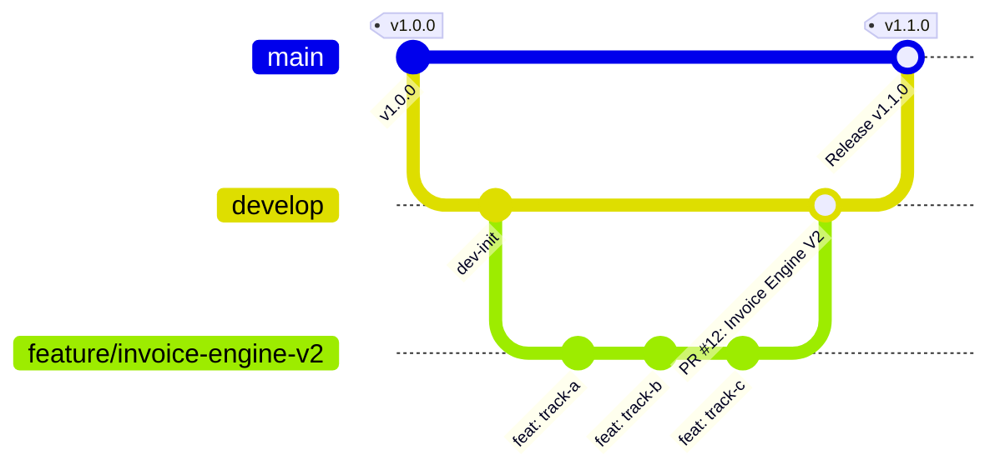

# Git & Pull Request (PR) Workflow Protocol

This document defines the official engineering workflow, branching strategy, commit standards, and Pull Request (PR) protocols for this monorepo.

---

## 1. Branching Strategy

Our repository follows a structured Git-flow model with two permanent branches:



| Branch | Purpose | Protection Rules |
| :--- | :--- | :--- |
| **`main`** | Production-ready releases. Deployed to production environments. | Strictly protected. No direct pushes. Requires PR from `develop` and passing CI/CD. |
| **`develop`** | Integration branch for ongoing development and testing. | Protected. No direct pushes. All new work merges into `develop` via Pull Requests. |
| **`feature/<name>`** | Scoped feature work (e.g. `feature/invoice-engine-v2`). | Branched off `develop`. Merges back into `develop` via PR. |
| **`fix/<name>`** | Bugfixes and issue patches. | Branched off `develop` (or `main` for hotfixes). |
| **`refactor/<name>`** | Internal refactors with zero functional change. | Branched off `develop`. |

---

## 2. Feature Development Lifecycle

### Step 1: Branch from `develop`
Never branch from stale local state or directly from `main`:
```bash
git checkout develop
git pull origin develop
git checkout -b feature/<descriptive-kebab-name>
```

### Step 2: Atomic Micro-Commits
Commit frequently in small, logical chunks rather than a single monolithic commit at the end of the sprint:
* Each commit should represent one cohesive change (e.g., a schema migration, an API endpoint, a test suite, a UI component).
* Keep commits buildable: every commit should compile without breaking the build.

### Step 3: Conventional Commit Standards
All commit messages must adhere to the [Conventional Commits](https://www.conventionalcommits.org/) specification:

```
<type>(<scope>): <short imperative summary>

[optional body explaining rationale and context]
```

* **Types**:
  * `feat`: A new feature or capability.
  * `fix`: A bug fix or error correction.
  * `refactor`: Code restructuring without changing behavior.
  * `test`: Adding or correcting tests.
  * `docs`: Documentation, ADRs, or README updates.
  * `chore`: Build scripts, dependencies, or configuration changes.
* **Scope examples**: `invoices`, `drafts`, `db`, `engine`, `auth`, `ui`.

---

## 3. Pre-PR Quality Gates (Local Verification)

Before opening or requesting review on a Pull Request, run the local quality checks:

```bash
# 1. Run full unit and integration test suite
pnpm --filter @starter/api test

# 2. Verify TypeScript across all workspaces
pnpm --filter @starter/api typecheck
pnpm --filter @starter/web typecheck

# 3. Verify linting & formatting (Husky / Biome)
pnpm lint
```

**Zero tolerance policy**: PRs with failing tests or TypeScript errors will not be merged.

---

## 4. Pull Request (PR) Protocol

### Creating the PR
1. Push your feature branch:
   ```bash
   git push -u origin feature/<descriptive-kebab-name>
   ```
2. Target **`develop`** as the base branch (never target `main` directly for feature work).
3. Fill in the PR description template:

```markdown
## Summary of Changes
- High-level overview of what this PR introduces or resolves.

## Tracks / Work Completed
- [x] Track A: Multi-draft collaboration & state machine
- [x] Track B: Precision math & domain generalization
- [x] Track C: Smart expenses & formula functions

## Architecture & ADR References
- Relates to ADR-0001, ADR-0002, ADR-0004 in `.agents/decisions/`

## Testing Evidence
- [x] 46/46 API test files passing (375 tests)
- [x] API typecheck: Clean (0 errors)
- [x] Web typecheck: Clean (0 errors)

## Breaking Changes / Database Migrations
- Detail any schema changes or env variables required.
```

### Review & Merge Strategy
* **Squash and Merge** (or Rebase Merge): Preferred to keep a clean, linear git history on `develop`.
* Delete the feature branch upon successful merge to prevent branch clutter.
