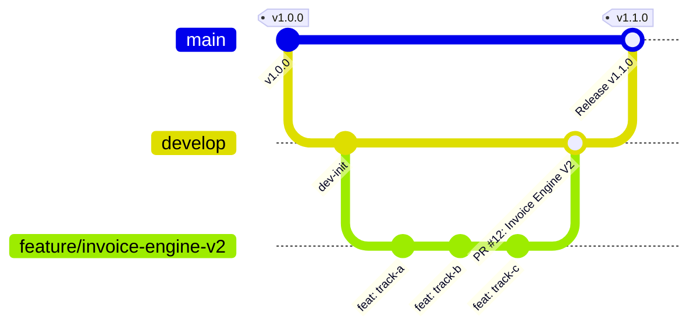
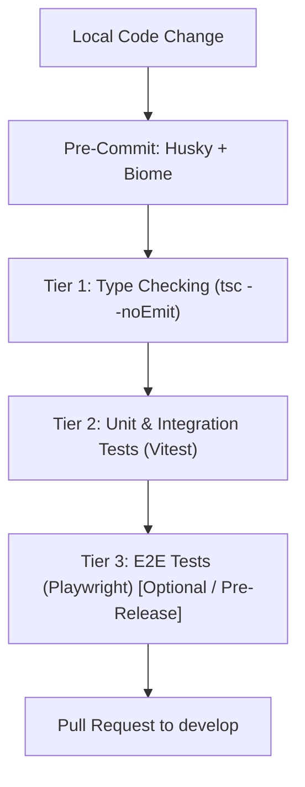

# Git & Pull Request (PR) Workflow Protocol

This document defines the official engineering workflow, branching strategy, commit standards, testing architecture, and Pull Request (PR) protocols for this monorepo.

---

## 1. Branching Strategy

Our repository follows a structured Git-flow model with two permanent branches:



| Branch | Purpose | Protection Rules |
| :--- | :--- | :--- |
| **`main`** | Production-ready releases. Deployed to production environments. | Strictly protected. No direct pushes. Requires PR from `develop` and passing CI/CD. |
| **`develop`** | Integration branch for ongoing development and testing. | Protected. No direct pushes. All new work merges into `develop` via Pull Requests. |
| **`feature/<name>`** | Scoped feature work (e.g. `feature/invoice-engine-v2`). | Branched off `develop`. Merges back into `develop` via PR. |
| **`fix/<name>`** | Bugfixes and issue patches. | Branched off `develop` (or `main` for hotfixes). |
| **`refactor/<name>`** | Internal refactors with zero functional change. | Branched off `develop`. |

---

## 2. Feature Development Lifecycle

### Step 1: Branch from `develop`
Never branch from stale local state or directly from `main`:
```bash
git checkout develop
git pull origin develop
git checkout -b feature/<descriptive-kebab-name>
```

### Step 2: Atomic Micro-Commits
Commit frequently in small, logical chunks rather than a single monolithic commit at the end of the sprint:
* Each commit should represent one cohesive change (e.g., a schema migration, an API endpoint, a test suite, a UI component).
* Keep commits buildable: every commit should compile without breaking the build.

### Step 3: Conventional Commit Standards
All commit messages must adhere to the [Conventional Commits](https://www.conventionalcommits.org/) specification:

```
<type>(<scope>): <short imperative summary>

[optional body explaining rationale and context]
```

* **Types**:
  * `feat`: A new feature or capability.
  * `fix`: A bug fix or error correction.
  * `refactor`: Code restructuring without changing behavior.
  * `test`: Adding or correcting tests.
  * `docs`: Documentation, ADRs, or README updates.
  * `chore`: Build scripts, dependencies, or configuration changes.
* **Scope examples**: `invoices`, `drafts`, `db`, `engine`, `auth`, `ui`.

---

## 3. Git Hooks & Code Quality Tooling

### Husky Automation
The repository uses [Husky](https://typicode.github.io/husky/) to automatically enforce code standards locally:
1. **`.husky/pre-commit`**:
   Automatically runs `pnpm exec biome check --write --staged --no-errors-on-unmatched` before every commit. This formats, lints, and organizes imports for all staged files. Any non-fixable lint violation halts the commit.
2. **`.husky/commit-msg`**:
   Validates the commit message against the Conventional Commits regex pattern:
   `^(build|chore|ci|docs|feat|fix|perf|refactor|revert|style|test)(\(.+\))?(!)?: .{1,}`
   Commits with invalid headers (e.g., `updated stuff`, `WIP`) are rejected immediately.

### Biome Tooling (Linting & Formatting)
We use [Biome](https://biomejs.dev/) for sub-millisecond linting, code formatting, and import organization:
```bash
# Check and auto-fix formatting & linting issues across the entire project
pnpm check

# Format all files
pnpm format

# Run linter only (via Turborepo)
pnpm lint

# CI verification (fails if any file requires formatting or contains lint errors)
pnpm check:ci
```

---

## 4. Testing Architecture & Quality Gates

Our codebase implements a multi-tier testing and verification strategy:



### Tier 1: TypeScript Type Checking
Ensures strict type-safety across all monorepo workspaces (`@starter/api`, `@starter/web`, `@starter/db`):
```bash
# Typecheck all workspaces in topological dependency order
pnpm typecheck
# Or target individual workspaces
pnpm --filter @starter/api typecheck
pnpm --filter @starter/web typecheck
```

### Tier 2: Vitest Unit & Integration Testing (Mandatory)
Every API endpoint, formula evaluator rule, precision boundary, and database transition is verified using Vitest:
```bash
# Run all tests across the monorepo via Turborepo
pnpm test

# Run API unit and integration test suite directly
pnpm --filter @starter/api test

# Interactive watch mode for test-driven development
pnpm --filter @starter/api test:watch

# Generate code coverage report (V8 engine)
pnpm --filter @starter/api test:coverage
```

### Tier 3: Playwright End-to-End (E2E) Testing (Optional / Pre-Release)
The `@starter/e2e` workspace contains browser-based end-to-end tests validating full user journeys (authentication, multi-tenancy, PBAC permission boundaries, invoice workflows, and UI interactions):
* **When to run**: Optional during routine micro-commits; **recommended before merging major feature branches into `develop` or preparing production releases**.
* **Automatic Web Server**: Playwright automatically boots the Next.js frontend and backend API on `http://localhost:5002` (`pnpm dev`) with a 120-second timeout.

```bash
# Run full headless E2E test suite
pnpm test:e2e

# Interactive Playwright UI mode (visual step-by-step inspector & time travel)
pnpm test:e2e:ui

# Headed mode (runs tests in a visible browser window)
pnpm test:e2e:headed

# Debug mode with breakpoints
pnpm --filter @starter/e2e test:e2e:debug
```

---

## 5. Pre-PR Checklist

Before opening or requesting review on a Pull Request, verify that all quality gates pass:

```bash
# 1. Staged files formatted and linted
pnpm check:ci

# 2. Monorepo TypeScript check (0 errors)
pnpm typecheck

# 3. Unit & Integration test suite passing (100% pass rate)
pnpm test

# 4. (Optional / Major Milestone) End-to-End browser tests
pnpm test:e2e
```

**Zero tolerance policy**: PRs with failing tests, lint violations, or TypeScript errors will not be merged.

---

## 6. Pull Request (PR) Protocol

### Creating the PR
1. Push your feature branch:
   ```bash
   git push -u origin feature/<descriptive-kebab-name>
   ```
2. Target **`develop`** as the base branch (never target `main` directly for feature work).
3. Fill in the PR description template:

```markdown
## Summary of Changes
- High-level overview of what this PR introduces or resolves.

## Tracks / Work Completed
- [x] Track A: Multi-draft collaboration & state machine
- [x] Track B: Precision math & domain generalization
- [x] Track C: Smart expenses & formula functions

## Architecture & ADR References
- Relates to ADR-0001, ADR-0002, ADR-0004 in `.agents/decisions/`

## Testing Evidence
- [x] Vitest: All API unit & integration test files passing (100% pass rate)
- [x] TypeScript: Clean typecheck across all workspaces (0 errors)
- [x] Biome: Formatting & lint checks passing (pnpm check:ci)
- [x] Playwright E2E: Verified critical paths (optional/applicable)

## Breaking Changes / Database Migrations
- Detail any schema changes or env variables required.
```

### Review & Merge Strategy
* **Squash and Merge** (or Rebase Merge): Preferred to keep a clean, linear git history on `develop`.
* Delete the feature branch upon successful merge to prevent branch clutter.
