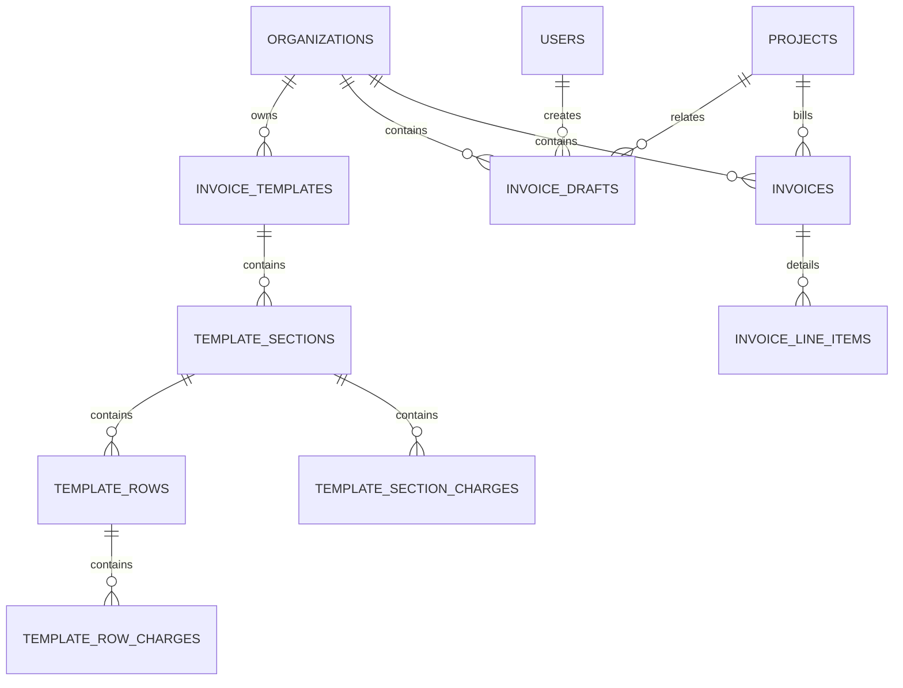

# Database Schema & Drizzle ORM Architecture Directives

**Location:** `packages/db/AGENTS.md`  
**Binding Architectural Contract for AI Agents**

---

## 1. Core Principles & Schema Invariants

1. **Multi-Tenant Foundation (`organizationId`)**:
   - Every tenant-scoped table MUST declare an `organizationId` column with a foreign key referencing `organizations.id` with `onDelete: "cascade"`.
   - Never allow cross-tenant queries. Indexes MUST include `organizationId` for high-concurrency read efficiency.
2. **Schema Normalization vs. JSONB Dynamic Storage**:
   - Core relational entities (Clients, Projects, Invoices, Invoices Drafts, Products, Purchases, Sales) are normalized tables with standard columns.
   - Dynamic tenant attributes use PostgreSQL `jsonb` columns:
     - `projects.customFields` (governed by `custom_field_definitions`)
     - `invoice_drafts.draftSections`, `draftConstants`, `draftHeaderValues`
     - `invoices.historicalFormat`, `resolvedHeaderValues`
     - `invoice_drafts.editHistory` (audit trail)
3. **Plural Table Naming**:
   - All PostgreSQL tables MUST use plural snake_case identifiers (e.g. `invoices`, `invoice_drafts`, `custom_field_definitions`).

---

## 2. Invoice & Billing Schema Contract

### Key Invariants:
1. **Immutable Historical Snapshots**:
   - When finalized into `invoices`, `historicalFormat` and `resolvedHeaderValues` capture the exact state at freeze time.
   - Line items in `invoice_line_items` store evaluated values as `numeric(20, 6)` strings.
2. **Multi-Draft Collaboration**:
   - `invoice_drafts` allows unlimited concurrent drafts per project.
   - `editHistory` logs JSONB audit entries (`userId`, `userName`, `userEmail`, `editedAt`, `action`).
3. **Formula Codec Tags**:
   - Formulas are stored in the database with immutable UUID references: `{{$tok:UUID}}`, `{{$tok:UUID}}`, `{{$tok:UUID}}`.
   - External tokens (`FILE_*`, `GBL_*`, `EXP_*`) remain plain text UPPER_SNAKE_CASE.

---

## 3. Custom Fields (4-Category System)
- **Category 1**: Configurable System Fields (`isDetailed`, `isSensitive`, `isPrivate`).
- **Category 2**: Custom Fields (`custom_field_definitions` + JSONB).
- **Category 3**: Immutable Auto-Metadata (`createdAt`, `updatedAt`).
- **Category 4**: Computed / Financial Fields (Strict PBAC permission-gated).
